<div align="center">

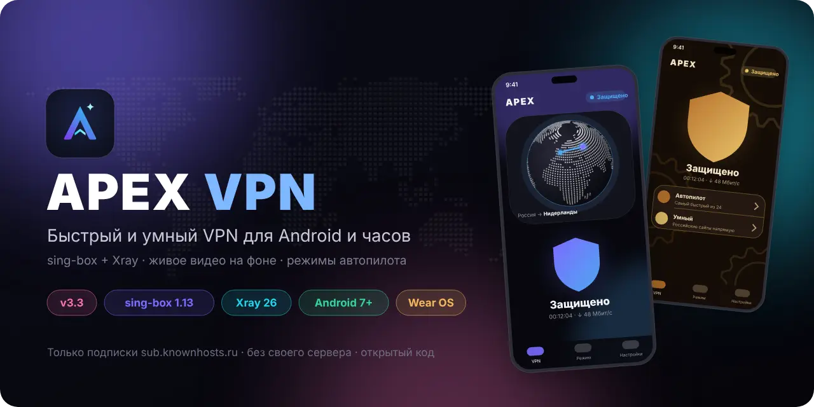

<br><br>

<a href="https://github.com/Dubstep2004/apex-vpn/releases/latest"></a>
<a href="#setup"></a>
<a href="#whatsnew"></a>

<a href="#features"></a>
<a href="#designs"></a>
<a href="#original"></a>

<h3>Быстрый и умный VPN-клиент для Android и часов Wear OS</h3>

<p><b>Два ядра</b> · все популярные протоколы · <b>свои списки</b> с шаблонами · <b>3D-глобус</b> · <b>13 дизайнов</b>, палитры и <b>живое видео на фоне</b><br>
автопилот с белыми списками · DNS «Авто» для каждой сети · базы сайтов каждый день · часы Wear OS</p>

<sub>📱 Android — <b>3.18.0</b> (Android 7+) · sing-box 1.13 · Xray 26</sub><br>
<sub>💬 Поддержка: <a href="https://t.me/Apexx_support">@Apexx_support</a></sub>

</div>

---

> [!NOTE]
> APEX VPN работает только с подпиской `https://sub.knownhosts.xyz/…`. Ссылку можно вставить, отсканировать по QR-коду или открыть через `apexvpn://import?url=…`.

<div align="center">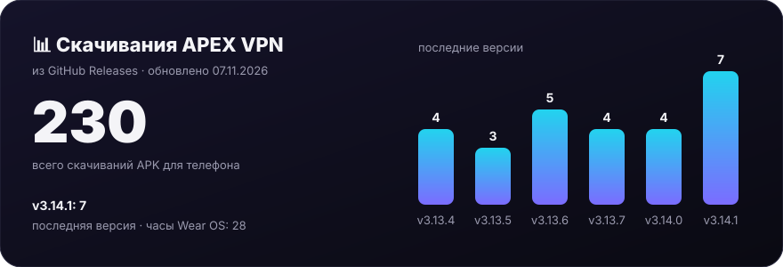</div>
<div align="center"><sub>Обновляется раз в день автоматически</sub></div>

<a id="setup"></a>


<table>
<tr>
<td width="33%" valign="top">

**📱 Пользователю**
Установить, обновлять, настроить.
<br>→ [Установка на телефон](#install)
<br>→ [Обновление](#update)
<br>→ [Свои списки сайтов](#lists)
<br>→ [Живое видео и шаблон «Скрыть VPN»](#video) 🆕
<br>→ [Тест скорости 3.0](#speed)
<br>→ [Облик 2.0: дизайн, цвет, звуки](#look)
<br>→ [Глобус, фото страны, темы](#globe)
<br>→ [Скрыть VPN от приложений](#hide)
<br>→ [Android TV](#tv)
<br>→ [APEX Watch (часы)](#watch)
<br>→ [Трафик, справка, Tasker](#traffic)
<br>→ [Космос, Японский, 3D-щит](#themes)
<br>→ [DNS «Авто» и автопилот](#dns)
<br>→ [Белые списки, DNS для каждой сети](#wl)
<br>→ [Эффекты фото и палитры](#photo)
<br>→ [Базы сайтов: обновление каждый день](#rules)
<br>→ [Надёжность: VPN не отключается](#reliability)
<br>→ [Быстрый LTE и «О приложении»](#lte)
<br>→ [Режимы автопилота](#modes)
<br>→ [Настройки пинга](#ping)
<br>→ [Утечки, журнал, сайты стран](#privacy)
<br>→ [Резервная копия](#backup)
<br>→ [Перенос на новый телефон](#transfer)
<br>→ [Очистить данные](#clear)
<br>→ [Ссылка-приглашение](#invite)

</td>
<td width="33%" valign="top">

**❓ Помощь**
Частые проблемы и поддержка.
<br>→ [Конец подписки](#expiry)
<br>→ [Написать в поддержку](#support)
<br>→ [Оригинал и подделки](#original)
<br>→ [Если что-то не так](#faq)

</td>
</tr>
</table>

> [!TIP]
> Каждая инструкция — отдельная вкладка: нажмите на заголовок, чтобы открыть.

<a id="install"></a>
<details open>
<summary><b>📲 Установка на телефон</b></summary>

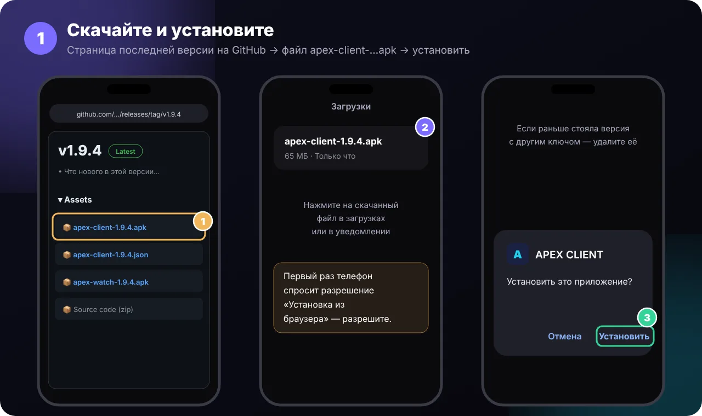

1. Откройте на телефоне **[последнюю версию](https://github.com/Dubstep2004/apex-vpn/releases/latest)**.
2. В разделе **Assets** нажмите **`apex-vpn-<версия>.apk`** — файл скачается.
3. Откройте скачанный файл и нажмите **«Установить»**. Первый раз телефон попросит разрешить установку из браузера — разрешите.
4. При первом запуске — короткое **знакомство** из трёх экранов → **«Начать»** (или «Пропустить»).
5. Вставьте ссылку подписки `https://sub.knownhosts.xyz/…` или нажмите **«Сканировать QR-код»** — подходит и QR подписки, и [QR переноса со старого телефона](#transfer).
6. Проверьте подлинность: **Настройки → О приложении** — зелёная строка **«✓ Официальная сборка»** ([подробнее](#original)).
7. Переустанавливали приложение? **Настройки → Резервная копия → «Восстановить из файла»** — вернутся все настройки и подписка ([подробнее](#backup)).

> [!WARNING]
> Ошибка **«Приложение не установлено, так как оно конфликтует с другим пакетом»** — старая версия подписана другим ключом. Удалите APEX VPN (Настройки → Приложения → APEX VPN → Удалить) и установите заново. Это нужно **один раз**.

</details>

<a id="update"></a>
<details>
<summary><b>🔔 Как приходит обновление</b></summary>

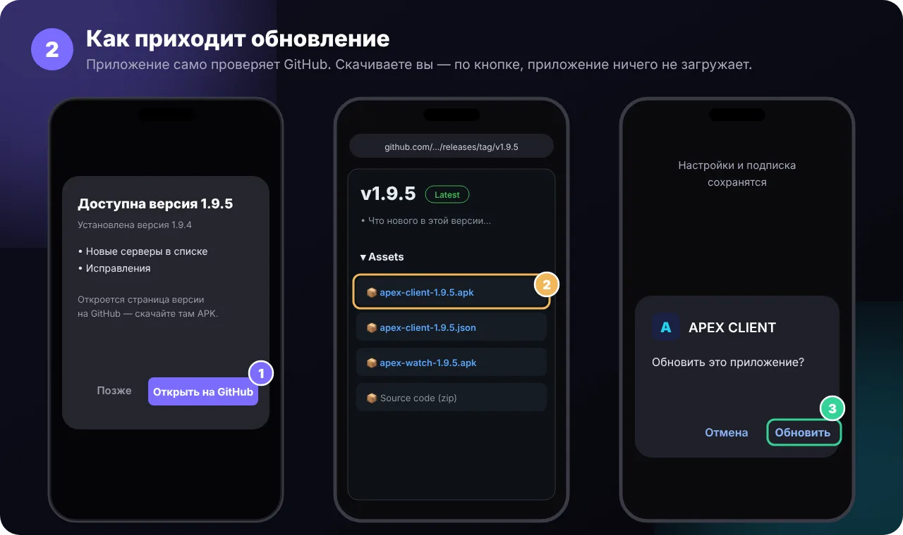

Приложение само проверяет GitHub — при запуске и раз в час. С версии **3.4 — обновление в один клик**:

1. Появляется окно **«Доступна версия …»** со списком изменений (или уведомление, если приложение закрыто).
2. Нажмите **«Обновить»**: приложение скачает `apex-vpn-<версия>.apk` из релиза (с докачкой при обрыве), сверит **SHA-256** и **подпись** — повреждённый или чужой файл не ставится.
3. В окне Android нажмите **«Установить»**. Настройки и подписка сохранятся, VPN включится снова сам.

В первый раз Android попросит разрешить **установку из APEX VPN** — приложение само откроет этот экран. На Android 12+ следующие обновления могут ставиться **без вопроса**: прошлую версию уже поставил сам APEX.

**Настройки → Обновления:** «Проверять автоматически», **«Бета-версии»** (новое раньше всех), **«Вернуть прошлую версию»** (по шагам, с копией настроек), **«Обновить часы APEX Watch»**, **«Ставить само»** (скачает заранее и поставит, когда VPN выключен или экран погас), **«Только по Wi-Fi»**, «Проверить сейчас». Обновление в один клик работает начиная с 3.4 — на 3.4 переходите как раньше, через страницу версии на GitHub.

> [!NOTE]
> Проверка работает, пока репозиторий **публичный**. Если сделать его приватным, приложение не увидит новых версий.

</details>

<a id="lists"></a>
<details>
<summary><b>📋 Свои списки сайтов</b></summary>


Свои наборы сайтов, которые идут **через VPN**: например «Работа» или «Игры».

1. Вкладка **Режим** → раздел **Свои списки** → **«Новый список»**.
2. Выберите **готовый шаблон** или **«Пустой список»**:
   - 🎮 **Игры** — Steam, Epic, Riot, Battle.net, EA, Ubisoft, PlayStation, Xbox, Nintendo, Roblox, Minecraft…
   - 🤖 **Нейросети** — Midjourney, Hugging Face, Mistral, Character.AI, Poe, Suno, ElevenLabs, Cursor…
   - 💼 **Работа** — Slack, Zoom, Atlassian, Microsoft 365, Asana, Miro, Canva, Dropbox…
   - 💻 **Разработка** — GitHub, GitLab, Docker, npm, PyPI, Stack Overflow, JetBrains…
   - 🎓 **Учёба**, 🎬 **Кино и сериалы**, 🎧 **Музыка**, 💬 **Соцсети**, 🛍️ **Покупки**

   Отметьте галочками несколько шаблонов и нажмите **«Добавить»** — они появятся сразу. Нажатие на шаблон открывает его для правки перед сохранением.
3. Проверьте **название** и **сайты** — добавьте своё или уберите лишнее.
   Сайты пишутся **по одному на строку**:
   - `example.com` — сайт со всеми поддоменами;
   - `full:mail.example.com` — только этот адрес;
   - `keyword:corp` — все сайты, где есть слово;
   - `10.8.0.0/16` или `1.2.3.4` — IP-адрес или подсеть;
   - `udp:27000-27100`, `tcp:25565` — порты (игры).
4. Выберите **цвет** и нажмите **«Сохранить»**.

Переключатель справа включает и выключает список. Нажатие на список — **изменить** или **удалить**. Проверить, куда пойдёт сайт: **Режим → Проверить сайт** — там будет написано, в каком списке сайт.

Рядом — **26 готовых сервисов** (YouTube, Instagram, Telegram, ChatGPT, Netflix, Spotify, Reddit, Signal, Viber, Notion, Figma и другие). Выключенный сервис идёт напрямую.

</details>

<a id="video"></a>
<details>
<summary><b>🎬 Живое видео на фоне и шаблон «Скрыть VPN»</b> <sup>3.3</sup></summary>

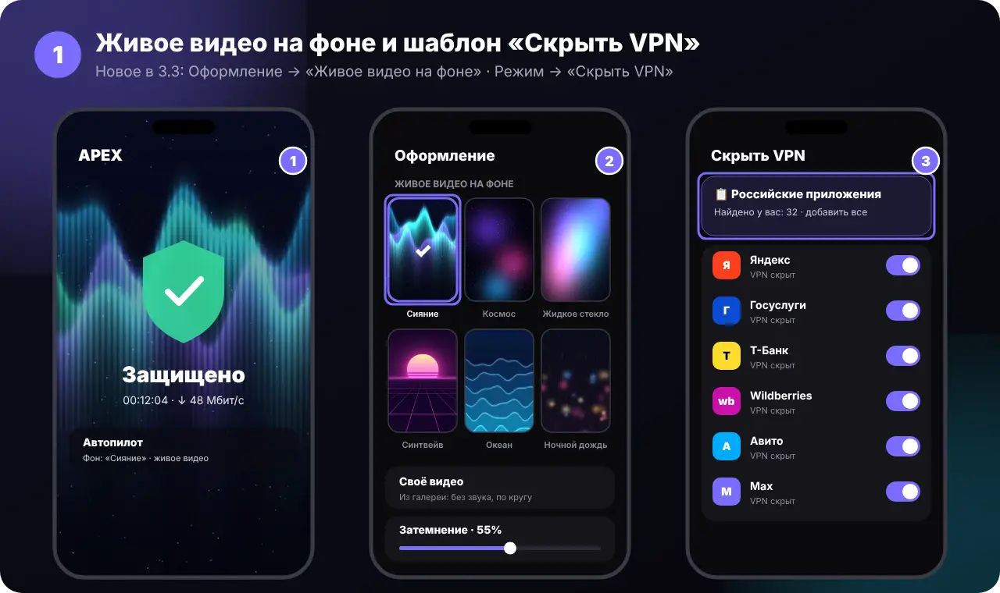

**Живое видео на фоне главного экрана:**

1. **Настройки → Оформление** → блок **«Живое видео на фоне»**.
2. Выберите готовый шаблон — **Сияние, Космос, Жидкое стекло, Синтвейв, Океан** или **Ночной дождь** (бесшовная петля, встроены в приложение, интернет не нужен).
3. Или **«Своё видео»** — любое видео из галереи (до 150 МБ).
4. Ползунок **«Затемнение»** — чтобы щит и надписи хорошо читались.

Видео идёт **без звука** и останавливается, когда приложение свёрнуто. Нажмите на выбранный шаблон ещё раз, чтобы убрать его.

**Шаблон «Скрыть VPN» — российские приложения:** вкладка **Режим → «Скрыть VPN от приложений»** → сверху карточка **«📋 Шаблон: Российские приложения»**. Одно нажатие — и мимо VPN пойдут все установленные приложения, которые проверяют VPN: Яндекс (Go, Карты, Маркет, Музыка, Кинопоиск…), VK и Max, Госуслуги, банки, Ozon и Wildberries, Авито, операторы связи, Почта России и другие. Нажмите ещё раз — уберёт их обратно.

> [!NOTE]
> Список собран по сообщениям СМИ и пользователей за 2026 год. Если какого-то приложения нет — включите его вручную в том же списке.

</details>

<a id="speed"></a>
<details>
<summary><b>⚡ Тест скорости 3.0</b> <sup>3.2</sup></summary>


1. **Настройки → Инструменты → Тест скорости** (или кнопка на главном экране).
2. Сразу видно **провайдера** (название, IP, город) и **сервер теста** — ближайший узел Cloudflare. Если VPN включён — это провайдер сервера VPN, так и должно быть.
3. Нажмите большую кнопку **«Начать»** в центре спидометра — пинг, **джиттер**, загрузка и отдача.
4. **Настройки теста:**
   - **Единицы** — Мбит/с, МБ/с или КБ/с;
   - **Масштаб** спидометра — 100, 500 или 1000;
   - **Соединение** — **множественное** (4 потока, вся ширина канала, как Speedtest) или **одинарное** (как качает браузер или видео).
5. Ниже — **история** замеров и **«Самый быстрый сервер»**.

Тест расходует около 50–150 МБ (при множественном соединении — больше).

</details>

<a id="look"></a>
<details>
<summary><b>🎨 Облик 2.0: дизайн, свой цвет, звуки</b></summary>


**Настройки → Оформление → «Дизайн, тема и иконка»**:

1. **Дизайн 2026 → APEX 3.2** — фирменный дизайн: крупные карточки и строки, мягкое свечение фона. Его название идёт за версией приложения. Дизайн по умолчанию для новых установок; у тех, кто обновился, остаётся прежний — его можно сменить здесь.
2. **Цвет → «Свой»** (радужный кружок) — ползунки **Оттенок**, **Насыщенность**, **Яркость** и 8 быстрых образцов. Пока тянете ползунок, меняется только образец; приложение перекрашивается, когда отпустите палец.
3. **Ощущения → Звук подключения** — 9 наборов: Сигнал, Кристалл, Сфера, Звон, **Космос**, **Ретро 8-бит**, **Капля**, **Арфа**, **Пульс**. ▶ — послушать.
4. **Звук отключения** — тот же набор «вниз» при выключении VPN. Нажмите на строку, чтобы послушать.

Вкладки внизу теперь плавно выезжают в сторону нажатой, а при запуске — **заставка 2.0**: щит рисуется линией, заливается цветом, появляется «APEX VPN 2.0». В **плавном режиме** анимации короче.

</details>

<a id="globe"></a>
<details>
<summary><b>🌍 Глобус, фото страны и новые темы</b></summary>

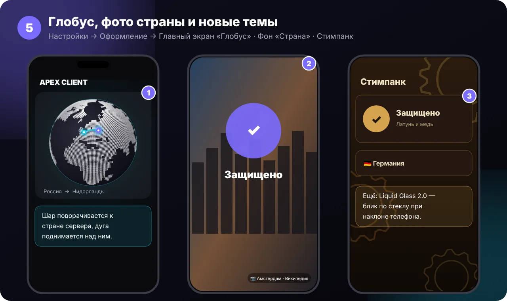

**Настройки → Оформление → «Дизайн, тема и иконка»**:

1. **Главный экран → «Глобус»** — вращающийся 3D-шар из точек. При смене сервера он поворачивается к его стране, дуга от вас до сервера поднимается над шаром, по ней бежит свет.
2. **Фон за щитом → «Страна»** — **фото дня**: каждый день новое фото города страны сервера (на автопилоте — вашей страны). Фото берутся из Википедии и загружаются раз в день; подпись внизу экрана.
3. **Дизайн → «Стимпанк»** — латунь, медь и медленно вращающиеся шестерёнки.
4. **Дизайн → «Liquid Glass 2.0»** — по стеклу карточек скользит блик, а цветные пятна за стеклом смещаются, когда вы наклоняете телефон.

Ещё в 2.1:
- смена дизайна, темы или цвета идёт **«волной»** — новые цвета растекаются кругом от места нажатия;
- **флаг переворачивается**, как карточка, когда меняется страна;
- **конфетти** на первом подключении и на юбилейных (10, 50, 100…);
- значки в настройках **«оживают»** при открытии;
- при первом запуске — **знакомство** из трёх экранов;
- на Android 12+ **живая иконка** на системной заставке.

> [!TIP]
> В приложении спрятана **секретная тема**. Подсказка: логотип в «О приложении» любит, когда на него нажимают 😉

В **плавном режиме** все эти анимации выключены или короче.

</details>

<a id="hide"></a>
<details>
<summary><b>🙈 Скрыть VPN от приложений</b></summary>


Некоторые приложения не работают с VPN (госуслуги, маркетплейсы, игры с защитой). Их можно пустить мимо VPN — тогда для них соединение обычное, и они не видят, что VPN включён.

1. Вкладка **Режим** → **«Скрыть VPN от приложений»**.
2. Найдите приложение поиском и включите переключатель.
3. Готово — VPN переподключится сам. Под названием будет **«VPN скрыт»**.

Быстрее — **готовый шаблон «Российские приложения»** сверху списка: одним нажатием скрывает VPN от всех установленных приложений, которые его проверяют (Яндекс, VK, Max, Госуслуги, банки, маркетплейсы, операторы). Подробнее — [Живое видео и шаблон «Скрыть VPN»](#video).

Раньше похожее было в **Настройки → Приложения** («Кроме выбранных») — в 3.3 этот пункт убран, а его список перенесён сюда.

Банки скрываются отдельно — переключателем **«Банки не увидят VPN»** рядом.

</details>

<a id="tv"></a>
<details>
<summary><b>📺 Android TV</b></summary>

Установите тот же `apex-vpn-<версия>.apk` на телевизор с Android TV / Google TV (например, через «Отправить файлы на ТВ» или флешку). APEX VPN появится в списке приложений.

На телевизоре главный экран другой:
- **слева** — большой 3D-глобус с дугой до сервера;
- **в центре** — щит: **OK** на пульте включает и выключает VPN;
- **справа** — страны крупными карточками: стрелками выберите страну, **OK** — подключиться. Выбранная карточка увеличивается и светится.

Подписку на ТВ удобно добавить [ссылкой-приглашением](#invite) или [переносом по QR](#transfer).

</details>

<a id="watch"></a>
<details>
<summary><b>⌚ APEX Watch — часы Wear OS</b></summary>


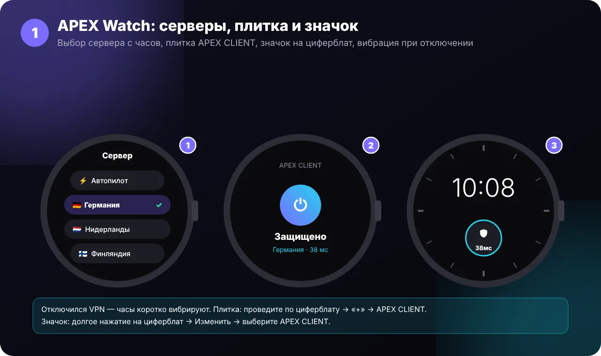

**APEX Watch** — пульт VPN на часах: кнопка включить/выключить, сервер, пинг и скорость. Работает вместе с APEX VPN на телефоне.

> [!WARNING]
> **`apex-watch-<версия>.apk` — только для часов.** Не открывайте его на телефоне: телефон покажет «APEX Watch — Обновить приложение?», но установить не даст (так и задумано — чтобы приложение для часов не заменило APEX VPN). На телефон ставится **`apex-vpn-<версия>.apk`**.

1. Откройте [последнюю версию](https://github.com/Dubstep2004/apex-vpn/releases/latest) и скачайте **`apex-watch-<версия>.apk`** на телефон — **не открывайте его**.
2. Передайте и установите на часы:
   - **Проще всего:** приложение **Wear Installer 2** на телефоне → включите на часах **Настройки → Для разработчиков → Отладка по Wi-Fi** → выберите файл `apex-watch-…apk` → **Установить на часы**;
   - **С компьютера:** `adb connect <IP часов>:<порт>`, затем `adb install apex-watch-<версия>.apk`.
3. На часах появится **APEX Watch** со своей иконкой — циферблат и щит.
4. **Сервер с часов:** пролистайте вниз → **«Сервер»** → выберите страну. Ниже — кнопка **GitHub** (откроется на телефоне).
5. **Плитка:** проведите по циферблату влево до конца → **«+»** → **APEX VPN**. Большая кнопка включает и выключает VPN.
6. **Значок на циферблат:** долгое нажатие на циферблат → **Изменить** → место для значка → **APEX VPN**. Показывает щит и пинг.
7. Если VPN отключился — часы **коротко вибрируют**.

Телефон и часы должны быть сопряжены, а APEX VPN — установлен на телефоне.

</details>

<a id="traffic"></a>
<details>
<summary><b>📊 Трафик по приложениям, справка и Tasker</b></summary>


**Трафик по приложениям** (Android 10+): **Настройки → Инструменты → «Трафик по приложениям»** — какие приложения сколько потратили через VPN, **сегодня** и **за 7 дней**. Считается только то, что идёт через VPN; данные хранятся только на телефоне.

**Справка в приложении:** **Настройки → О приложении → «Справка»** — те же инструкции с картинками, что здесь, без интернета.

**Автоматизация (Tasker, MacroDroid):**
1. **Настройки → Инструменты → «Автоматизация»** — включите (по умолчанию выключено, чтобы чужие приложения не управляли VPN).
2. В Tasker: **Система → Send Intent**, *Target: Activity*, пакет `com.apexvpn.client`. В MacroDroid: **Запустить активность / Отправить интент**.
3. Действие (Action):
   - `com.apexvpn.client.CONNECT` — включить; extra `server` = название сервера (например `Германия`) или `auto`;
   - `com.apexvpn.client.DISCONNECT` — выключить;
   - `com.apexvpn.client.TOGGLE` — переключить.

Первое включение VPN всё равно нужно разрешить в самом приложении — так требует Android.

</details>

<a id="themes"></a>
<details>
<summary><b>🌌 Космос, Японский минимализм, 3D-щит и самолётик</b></summary>


**Настройки → Оформление → «Дизайн, тема и иконка»**:
- **Космос** — мерцающие звёзды и туманность, вокруг щита летают две планеты и спутник;
- **Японский минимализм** — рисовая бумага, тушь, красный акцент и шрифт с засечками;
- **3D-щит** (раздел «Плавность») — щит поворачивается, когда вы наклоняете телефон;
- при смене сервера по **глобусу** и **карте** летит **самолётик** — от старой страны к новой.

</details>

<a id="dns"></a>
<details>
<summary><b>🧭 DNS «Авто», стабильный автопилот и объявления с картинкой</b></summary>


**DNS «Авто»:** **Настройки → DNS → «Авто»** (по умолчанию у новых установок). APEX сравнивает **Cloudflare, Google, Quad9, Mullvad, OpenDNS и Control D** по **DoH, DoT и DoQ** и берёт самый быстрый — **отдельно для каждой сети** (подробнее — [Белые списки и DNS для каждой сети](#wl)). Меняет DNS, только если другой заметно быстрее. Там же видно замер и кнопка **«Проверить сейчас»**.

**Все DNS** (Настройки → DNS):

| DNS | Чем хорош |
|---|---|
| **Авто** | сам выбирает самый быстрый из шести (DoH, DoT, DoQ), свой для каждой сети |
| **Cloudflare** · **Google** · **Quad9** | быстрые и надёжные; Quad9 ещё защищает от вредоносных сайтов |
| **AdGuard** | режет рекламу на уровне DNS |
| **Mullvad** · **NextDNS** | приватные, без журналов |
| **OpenDNS** · **Control D** | быстрые, без фильтров |
| **Яндекс DNS** | для российских сетей |
| **Comss.one** | открывает ИИ-сервисы, недоступные в России |
| **Свой DNS** | любой адрес DNS-over-HTTPS |

**Стабильный автопилот:**
- не выбирает **серверы России и обход LTE** — у них самый низкий пинг, но заблокированные сайты через них не открываются (выключается в **Настройки → Профиль → «Автопилот без России и LTE»**);
- меняет сервер, только если другой быстрее **на 150 мс**, и **не обрывает** видео и загрузки при смене;
- при подключении сразу берёт сервер, который был быстрее **в прошлый раз**, а не первый в списке.


</details>

<a id="wl"></a>
<details>
<summary><b>📶 Белые списки и DNS для каждой сети</b> <sup>2.4</sup></summary>


**Белые списки на мобильной сети** (Настройки → Профиль → **«Белые списки на мобильной сети»**, включено по умолчанию):
1. Работает, когда выбран **автопилот** и телефон на **мобильной сети**.
2. Раз в 5 минут APEX проверяет серверы. Если **обычные серверы не отвечают**, а **LTE-обход отвечает** — оператор включил белые списки.
3. Автопилот сам переходит на **LTE-обход** и присылает уведомление. Когда обычные серверы снова отвечают или вы перешли на Wi-Fi — возвращается обычный автопилот.
4. Не нужно — выключите переключатель, тогда автопилот никогда не берёт LTE-обход сам.

**Замер через сервер (2.7):** DNS проверяются через сервер VPN — так же, как они работают под VPN. Поэтому замер работает и на мобильной сети с белыми списками. Если не ответил ни один DNS, «Авто» ничего не меняет.

**DNS для каждой сети:** DNS «Авто» запоминает лучший DNS **отдельно** для каждой сети Wi-Fi (по названию сети), для мобильной связи и для проводной сети. При смене сети нужный DNS ставится сразу, а через 3 секунды APEX перепроверяет и, если нужно, меняет его.

**DoT и DoQ:** кроме DNS-over-HTTPS «Авто» проверяет **DNS-over-TLS** (Cloudflare, Google, Quad9, Mullvad, Control D) и **DNS-over-QUIC** (Control D). В **Настройки → DNS** видно, какой DNS и протокол выбран и для какой сети.

> Название Wi-Fi Android показывает только с разрешением на местоположение; без него все Wi-Fi сети считаются одной.

</details>

<a id="photo"></a>
<details>
<summary><b>🖼️ Эффекты своего фото и готовые палитры</b> <sup>2.4</sup></summary>


**Своё фото за щитом:** Настройки → Внешний вид → **Фон за щитом → «Своё фото»**. Под фото появятся настройки:
- **Размытие** — от 0 до 24 (работает на Android 12 и новее);
- **Затемнение** — от 0 до 90 %, чтобы текст и кнопки читались на любом фото;
- **Движение при наклоне** — фото слегка сдвигается, когда вы наклоняете телефон, как живые обои (в «Плавном режиме» выключено).

**Палитры:** Настройки → Внешний вид → **«Палитры»** — **Закат, Мята, Лаванда, Кофе, Океан, Вишня, Лайм, Золото, Полночь**. Палитра задаёт цвет кнопок и **двухцветный градиент щита**. Работает в дизайнах APEX 2, Классика, Liquid Glass, Аврора и Бенто; в остальных дизайнах свои цвета. Свой цвет через пипетку сбрасывает второй цвет палитры.

</details>

<a id="rules"></a>
<details>
<summary><b>📚 Базы сайтов: обновление каждый день</b> <sup>2.5</sup></summary>

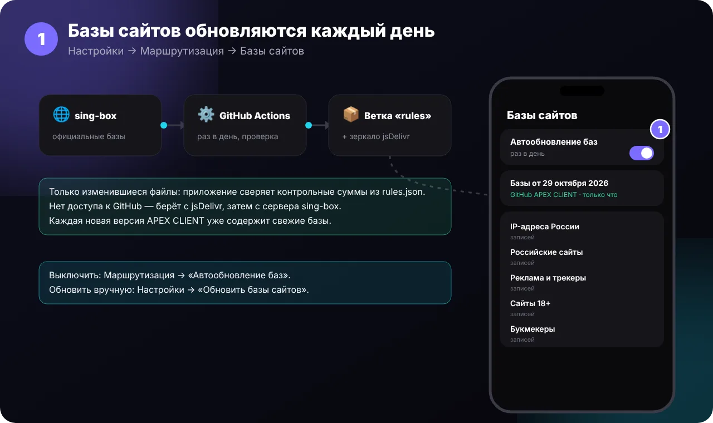

По базам APEX решает, что идёт **напрямую** (российские сайты и IP), что **блокируется** (реклама) и что закрывает **семейный режим**.

| База | Для чего |
|---|---|
| IP-адреса России | российские IP — напрямую |
| Российские сайты | российские сайты — напрямую |
| Реклама и трекеры | блокировка рекламы |
| Сайты 18+ · Букмекеры | семейный режим |

**Как обновляются:**
1. Раз в день GitHub Actions ([`rules.yml`](.github/workflows/rules.yml)) берёт свежие официальные базы sing-box, проверяет их и публикует в ветку [`rules`](https://github.com/Dubstep2004/apex-vpn/tree/rules) вместе с `rules.json` (контрольные суммы и число записей).
2. Приложение раз в день сверяет `rules.json` и качает **только изменившиеся** базы, затем незаметно перезагружает ядро.
3. Если GitHub недоступен — берёт базы с зеркала **jsDelivr**, затем с **сервера sing-box**.
4. Каждая новая версия приложения собирается уже со свежими базами.

**В приложении:**
- **Настройки → «Обновить базы сайтов»** — проверить прямо сейчас; в подписи видно, от какого числа базы и когда проверялись;
- **Настройки → «Автообновление баз»** — включить или выключить и выбрать, как часто: каждые 6 ч, 12 ч, каждый день или раз в неделю;
- **Настройки → Маршрутизация → Базы сайтов** — переключатель **«Автообновление баз»**, источник, последняя ошибка, размер и число записей каждой базы;
- там же можно указать **свой адрес баз** (`https://…/`) — тогда базы берутся только оттуда. Положите рядом `rules.json`, чтобы качались только изменения.

</details>

<a id="reliability"></a>
<details>
<summary><b>🛡️ Надёжность: VPN не отключается</b> <sup>2.6</sup></summary>

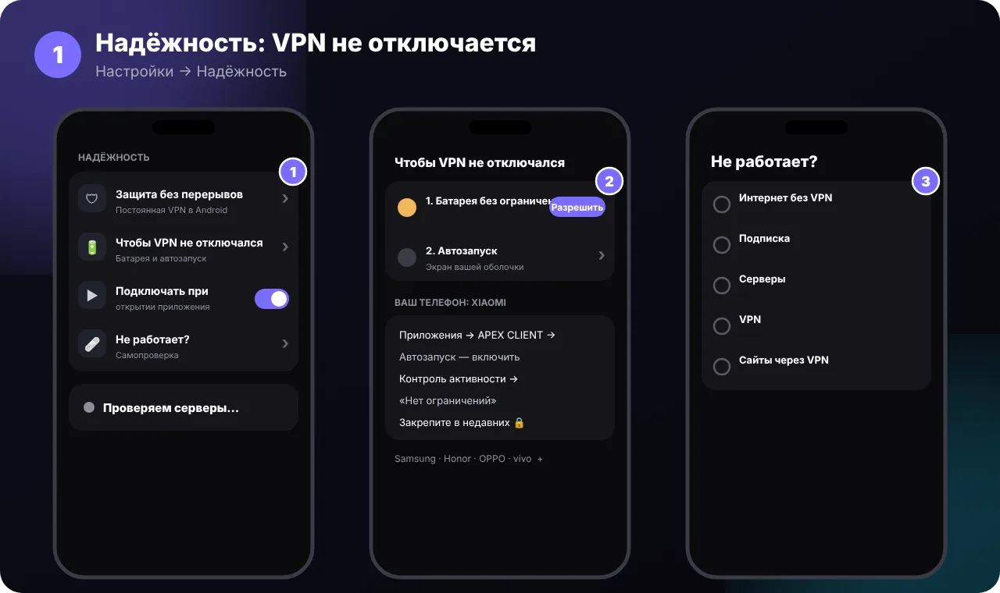

**Настройки → Надёжность:**
- **Защита без перерывов** — открывает настройки Android: включите «Постоянная VPN» и «Блокировать соединения без VPN».
- **Чтобы VPN не отключался** — многие телефоны закрывают фоновые приложения ради батареи, а вместе с ними и VPN:
  1. **Батарея без ограничений** — нажмите «Разрешить» и подтвердите системный запрос;
  2. **Автозапуск** — откроется экран вашей оболочки (Xiaomi, Honor/Huawei, Samsung, OPPO/realme, vivo), включите APEX VPN;
  3. ниже — пошаговая инструкция для **вашей марки** телефона и для остальных.
- **Подключать при открытии** — VPN включается сам, как только вы открыли приложение.
- **Не работает?** — самопроверка: интернет без VPN, подписка (срок и трафик), серверы, VPN и сайты. В конце — совет и кнопки **«Выбрать рабочий сервер»** и **«Включить автопилот»**.
- **Карточка серверов** — «Все серверы работают» или «Работают 18 из 24»; нажмите, чтобы проверить заново.

</details>

<a id="lte"></a>
<details>
<summary><b>📶 Быстрый LTE и «О приложении»</b> <sup>2.5–2.6</sup></summary>

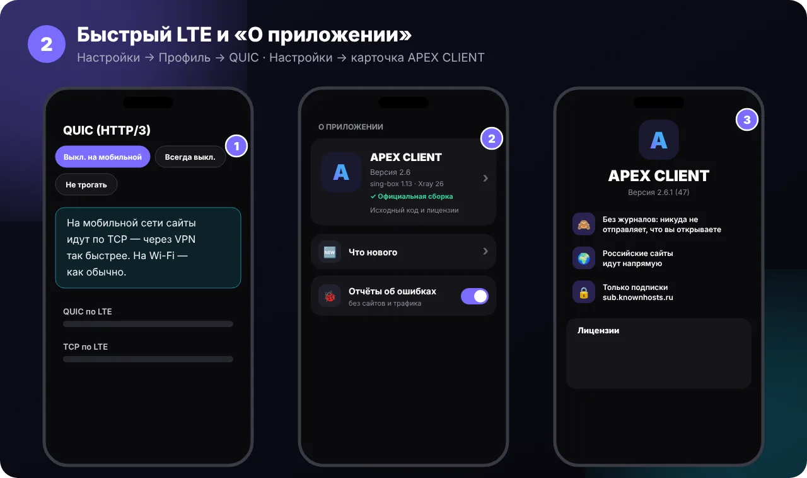

**Медленные сайты на LTE.** Chrome, YouTube и Google открывают сайты по QUIC (HTTP/3, это UDP). На мобильной сети UDP часто режут или теряют, и через VPN такие сайты грузятся медленно. Поэтому на мобильной сети APEX выключает QUIC — браузер сразу идёт по обычному HTTPS (TCP). На Wi-Fi всё как раньше; при смене сети приложение переключается само.

**Настройки → Профиль → QUIC (HTTP/3):** «Выкл. на мобильной» (по умолчанию), «Всегда выкл.» или «Не трогать».

Ещё для LTE: белые списки включают LTE-обход только после **второй** проверки, а DNS «Авто» на мобильной сети берёт только DoH и DoT (по TCP).

**О приложении:** нажмите на **карточку APEX VPN** в настройках — версия и ядра, конфиденциальность, исходный код этой версии на GitHub и **лицензии** открытых проектов. Там же рядом — **«Отчёты об ошибках»**: выключите, и отчёты о сбоях не будут сохраняться.

</details>

<a id="modes"></a>
<details>
<summary><b>🎮 Режимы автопилота</b> <sup>3.0</sup></summary>


Режим выбирается кнопками в **списке серверов** под «Автопилотом» или плитками в **Настройки → Режим автопилота**.

| Режим | Как выбирает сервер |
|---|---|
| ⚖️ **Обычный** | самый быстрый, меняет сервер, только если другой заметно быстрее |
| 🎮 **Игры** | каждый сервер проверяется 4 раза: только низкий и ровный пинг (маленький джиттер) без потерь, проверка каждую минуту |
| 🚀 **Скорость** | замер загрузки через 3 лучших сервера (≈ 9 МБ), автопилоту — 2 самых быстрых; перепроверка раз в 30 минут |
| 🛡 **Надёжный** | только серверы без потерь, которые ни разу не пропадали |
| 📞 **Звонки** | ровная связь, сервер не меняется во время разговора |
| 🔋 **Батарея** | проверки серверов раз в 30 минут |

- В режимах «Игры» и «Скорость» у серверов видно **джиттер, потери и Мбит/с**, а у выбранного сейчас — метка **«Автопилот»**.
- **Щит в цветах режима** (3.1): 🎮 красный пульс, 🚀 голубые полосы, 🛡 ровное кольцо, 📞 звуковые волны, 🔋 «дыхание». Выключается в Оформлении.
- Подбор повторяется раз в 15 минут; ядро перезагружается, только если подходящие серверы изменились.

</details>

<a id="ping"></a>
<details>
<summary><b>📶 Настройки пинга</b> <sup>2.8–2.9</sup></summary>


**Настройки → Инструменты → «Пинг»:**
- **Тип пинга:** **TCP — до сервера** (по умолчанию; для Hysteria — QUIC), **через прокси GET / HEAD** (запрос к сайту через каждый сервер, при включённом VPN), **ICMP** (обычный ping).
- **Режим через прокси:** **Обычный** (один запрос), **Double** (два запроса с новым соединением), **KeepAlive** (два по одному соединению — чистое время ответа). Берётся лучший.
- **Тайм-аут** 5–15 секунд, **свой адрес проверки** (его использует и автопилот), **вид результата**: время, столбики или вместе.

**Нажмите на пинг** в списке серверов — этот сервер перепроверится на месте, новый пинг подсветится, а список пересортируется.

</details>

<a id="privacy"></a>
<details>
<summary><b>🔒 Проверка утечек, журнал соединений, сайты стран</b> <sup>3.1</sup></summary>

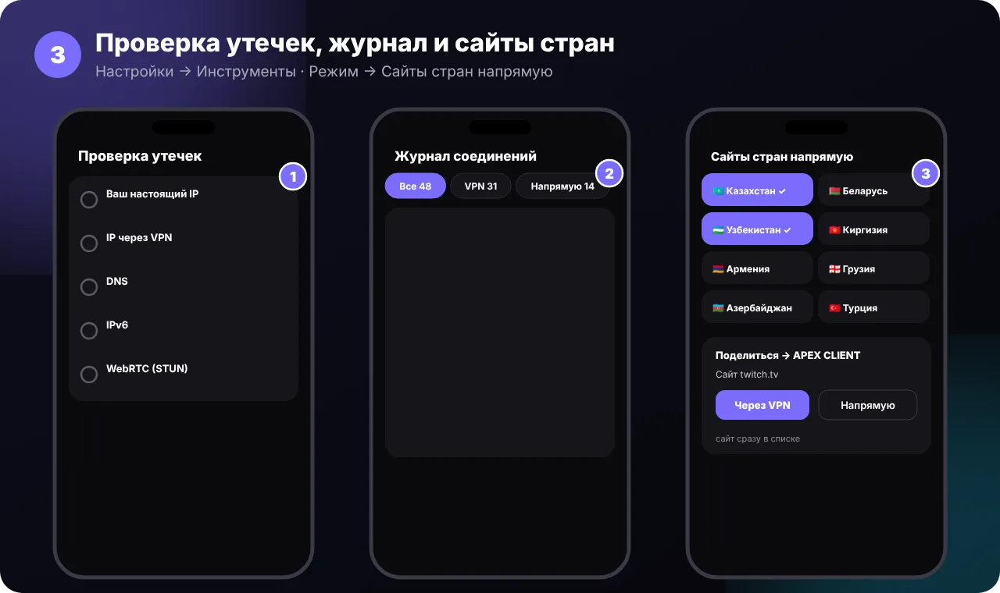

**Проверка утечек** (Настройки → Инструменты): ваш настоящий IP и IP через VPN (с флагом страны), какой **DNS** узнаёт адреса сайтов, не уходит ли **IPv6** мимо VPN и какой адрес видят **звонки и WebRTC**. Итог — «Утечек нет ✓» или что исправить.

**Журнал соединений** (Настройки → Инструменты): какие сайты шли **через VPN** (и через какой сервер), **напрямую** или были **заблокированы**; поиск и фильтры. Только на телефоне, последние 500 записей, сам стирается через сутки. По умолчанию выключен.

**Сайты стран напрямую** (Режим): 🇰🇿 Казахстан, 🇧🇾 Беларусь, 🇺🇿 Узбекистан, 🇰🇬 Киргизия, 🇦🇲 Армения, 🇦🇿 Азербайджан, 🇬🇪 Грузия, 🇹🇯 Таджикистан, 🇲🇩 Молдова, 🇹🇷 Турция — домен страны, её банки и сервисы мимо VPN.

**«Поделиться» сайтом:** в браузере «Поделиться» → **APEX VPN** → «Через VPN» или «Напрямую».

Ещё в 3.1: приветствие «☀️ Доброе утро! Защищено ✓» и галочка **«Удалить и все данные»** при удалении подписки.

</details>

<a id="backup"></a>
<details>
<summary><b>💾 Резервная копия настроек</b></summary>


При **обновлении поверх** все настройки сохраняются сами. Копия нужна, если приложение приходится **удалять** (например, при ошибке «конфликтует с другим пакетом») или вы переходите на новый телефон.

1. **Настройки → Резервная копия → «Сохранить настройки в файл»** → выберите папку (например, «Загрузки») → **Сохранить**. Файл `apex-vpn-settings.json`.
2. После установки: **Настройки → Резервная копия → «Восстановить из файла»** → выберите файл.
3. Вернутся все настройки, свои списки, правила, избранное, дизайн и **подписка**.

Ещё настройки попадают в **резервную копию Android** (Google), если она включена на телефоне, и возвращаются при установке сами.

> [!WARNING]
> В файле есть ссылка вашей подписки — не отправляйте его другим. Чтобы поделиться VPN с семьёй, используйте [ссылку-приглашение](#invite).

</details>

<a id="transfer"></a>
<details>
<summary><b>📲 Перенос на новый телефон</b></summary>


Без файлов и без интернета — одним QR-кодом.

1. **Старый телефон:** Настройки → Резервная копия → **«Перенести на новый телефон»**. Появится QR-код (яркость экрана станет максимальной).
2. **Новый телефон:** установите APEX VPN и нажмите **«Сканировать QR-код»** — на первом экране или в **Настройки → Резервная копия → «Принять с другого телефона»**.
3. Наведите камеру на QR-код. Появится окно со списком, что перенесётся, — нажмите **«Перенести»**.
4. Готово: вернутся **все настройки, свои списки, избранное, правила, выбранный сервер и подписка**.

> [!WARNING]
> В QR-коде ваша **личная подписка** — не показывайте его посторонним и не публикуйте скриншот. Если данных слишком много для одного QR, приложение предложит [файл](#backup).

</details>

<a id="expiry"></a>
<details>
<summary><b>⏰ Уведомления о конце подписки</b></summary>

APEX напомнит **три раза**: **за 3 дня**, **за 1 день** и **в момент окончания** — каждое уведомление один раз для каждой даты. Напоминания срабатывают точно по времени, даже если телефон без интернета. Ещё будет уведомление, если осталось меньше 10% трафика (не чаще раза в сутки).

Включить или выключить: **Настройки → Уведомления → «Конец подписки»**. Дату и обратный отсчёт видно в карточке подписки на главном экране.

</details>

<a id="clear"></a>
<details>
<summary><b>🧹 Очистить данные</b></summary>

**Настройки → Данные → «Очистить данные»** → **«Очистить»**.

Сбросятся все настройки, свои списки, правила, избранное, история тестов скорости, журналы, отчёты о сбоях, фото фона и кэш. **Подписка и выбранный сервер останутся**, иконка на рабочем столе не меняется.

> [!WARNING]
> Отменить нельзя. Если настройки могут понадобиться — сначала [сохраните резервную копию](#backup).

</details>

<a id="invite"></a>
<details>
<summary><b>💌 Ссылка-приглашение</b></summary>

Одна ссылка, по которой человек **скачивает приложение и сразу добавляет подписку**. Удобно для своего второго телефона или семьи.

**В приложении:** Настройки → Подписка → **«Ссылка-приглашение»** → отправить в любой мессенджер.

**Без приложения:** откройте страницу `https://dubstep2004.github.io/apex-vpn/invite/`, вставьте ссылку подписки — получите ссылку-приглашение и QR-код.

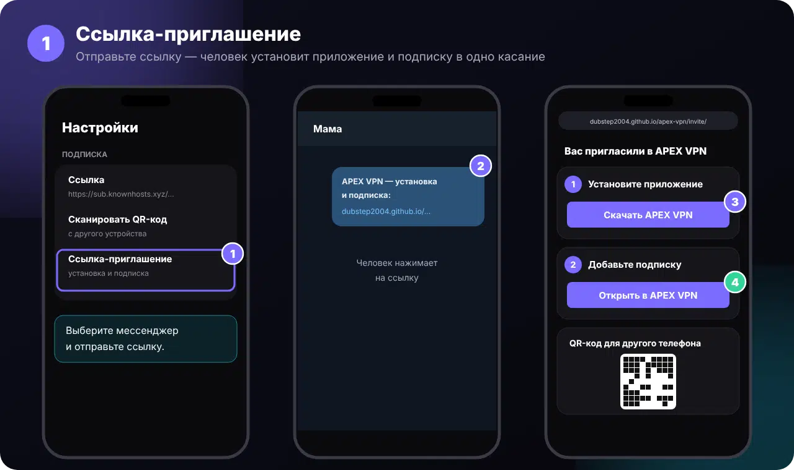

По ссылке открывается страница с тремя шагами: **Скачать APEX VPN** → **Открыть в APEX VPN** (подписка добавится сама) → QR-код для другого телефона.

> [!NOTE]
> Ссылка подписки стоит в приглашении **после знака `#`** — браузер не отправляет эту часть на сервер GitHub, она остаётся только на телефоне. Но по приглашению подключаются к **вашей** подписке — делитесь только с теми, кому доверяете.

</details>

<a id="support"></a>
<details>
<summary><b>🎧 Написать в поддержку</b></summary>


1. В приложении: **Настройки → Написать в поддержку**.
2. **«Скопировать отчёт»** — отчёт попадёт в буфер обмена. В нём версия, модель телефона, настройки, ошибки и журнал ядра. **Без ссылки подписки, адресов серверов и IP.**
3. **«Открыть чат поддержки»** — откроется чат из ссылки `support-url` вашей подписки, а если её нет — наша поддержка в Telegram **[@Apexx_support](https://t.me/Apexx_support)**.
4. Долгое нажатие в поле сообщения → **«Вставить»** → опишите проблему → отправьте.

Кнопка **«Поделиться файлом отчёта…»** — если удобнее отправить файлом.

</details>

<a id="original"></a>
<details>
<summary><b>🛡️ Оригинал и защита от подделок</b></summary>

Оригинальный APEX VPN скачивается **только** со страницы [Releases](https://github.com/Dubstep2004/apex-vpn/releases). Все версии подписаны ключом автора.

**Как проверить:** **Настройки → О приложении** — у оригинала зелёная строка **«✓ Официальная сборка»**.

Если кто-то перепакует APK (добавит рекламу, слежку или кражу подписки) и подпишет своим ключом, приложение это заметит:
- при каждом запуске покажет окно **«⚠ Неофициальная копия»** с кнопкой **«Скачать оригинал»**;
- на главном экране будет красная плашка, в уведомлении VPN — предупреждение;
- в отчёте для поддержки будет пометка **«НЕОФИЦИАЛЬНАЯ»** — поддержка сразу поймёт, в чём дело.

Сертификат подписи оригинала (SHA-256) — проверка на компьютере: `apksigner verify --print-certs файл.apk`

```
61:15:D6:55:A0:8D:FE:7C:97:0B:E7:DF:C1:1E:06:E3:5F:7E:C8:B8:BD:78:FF:5A:B7:82:F6:51:45:B1:00:D4
```

**Название и логотип.** Код открыт по GPL-3.0, но название «APEX VPN», логотип и иконки под эту лицензию не передаются — подробно в [TRADEMARKS.md](TRADEMARKS.md). Свою версию можно делать только под **другим названием и с другим логотипом**.

</details>

<a id="faq"></a>
<details>
<summary><b>❓ Если что-то не так</b></summary>

| Проблема | Что делать |
|---|---|
| Настройки пропали после переустановки | **Перед удалением:** Настройки → Резервная копия → **«Сохранить настройки в файл»**. После установки — **«Восстановить из файла»**. При обычном обновлении поверх настройки сохраняются сами. |
| «Конфликтует с другим пакетом» | Удалите APEX VPN один раз и установите заново. |
| Нет окна об обновлении | **Настройки → Обновления → Проверить сейчас**. Репозиторий должен быть публичным. «GitHub временно ограничил проверки» — подождите час. |
| Кнопка «Открыть на GitHub» не работает | Нужен браузер на телефоне. Или откройте вручную [страницу версий](https://github.com/Dubstep2004/apex-vpn/releases). |
| Сборка на GitHub красная | Откройте сборку в **Actions** — ошибка написана в блоке **Annotations**. |
| Приложение вылетает / не подключается | **Настройки → Написать в поддержку → «Скопировать отчёт»**, затем **«Открыть чат поддержки»** и вставьте отчёт в сообщение. В отчёте нет ссылки подписки и IP. |
| Нет кнопки «Открыть чат поддержки» | Ссылку на чат задаёт сервис: в Remnawave заполните **ссылку на поддержку (support-url)** в настройках подписки. |
| Нет фото страны | Нужен интернет; фото загружается раз в день. Для некоторых стран фото нет — тогда фон без фото. |
| Приложение не работает с VPN | Вкладка **Режим → «Скрыть VPN от приложений»** — отметьте его. |
| QR переноса не сканируется | Увеличьте яркость, держите телефон ровно на 15–25 см. Не получается — [перенос файлом](#backup). |
| «Подключите VPN — скорость меряется через сервер» | Подбор самого быстрого сервера работает только при включённом VPN. |
| Не приходят напоминания о подписке | Разрешите APEX VPN уведомления и проверьте **Настройки → Уведомления → «Конец подписки»**. |

</details>

<a id="features"></a>


<div align="center">
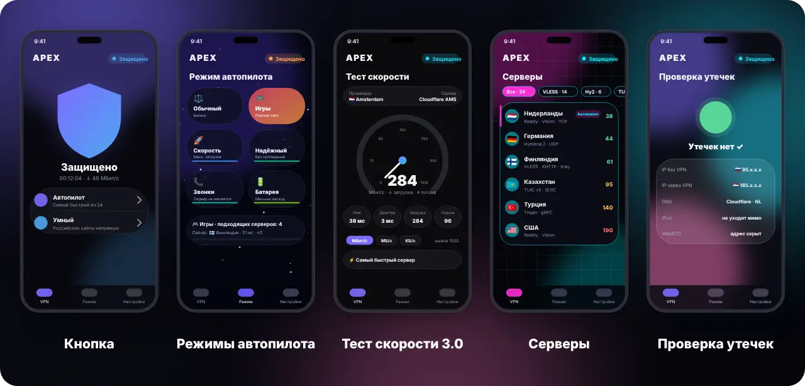
<br><sub>Иллюстрации интерфейса</sub>
</div>

<table>
<tr>
<td width="50%" valign="top">

### 🛡️ Подключение
- **Стабильный автопилот** выбирает самый быстрый сервер (без России и LTE-обхода), не прыгает между серверами и не рвёт соединения
- **13 DNS** и **«Авто»** — самый быстрый из шести по DoH, DoT и DoQ, **свой для каждой сети** (дом, работа, мобильная)
- **Белые списки**: если оператор пускает только «разрешённые» сайты, автопилот сам переходит на LTE-обход (отключается)
- **Быстрый LTE**: на мобильной сети QUIC выключается, сайты идут по TCP — через VPN так быстрее
- **Смена сервера без разрыва** VPN
- **Аварийный выключатель**: если VPN упал, интернет закрыт до переподключения
- **Режимы автопилота** (3.0): ⚖️ Обычный, 🎮 Игры (низкий ровный пинг без потерь), 🚀 Скорость (2 самых быстрых по замеру загрузки), 🛡 Надёжный, 📞 Звонки, 🔋 Батарея
- **Надёжность**: «Чтобы VPN не отключался» (батарея и автозапуск для Xiaomi, Samsung, Honor…), подключение при открытии, самопроверка «Не работает?» с выбором рабочего сервера
- **Ядро «Только Xray»** (Настройки → Ядро): все серверы, которые умеет Xray, — через Xray, как в Happ; Xray выходит в сеть напрямую, а не второй раз через туннель

</td>
<td width="50%" valign="top">

### 🧭 Маршрутизация
- **Умный режим**: российские сайты и IP идут напрямую
- **Базы сайтов обновляются каждый день** — качаются только изменения, есть запасные зеркала
- **Сервисы через VPN**: 26 готовых (YouTube, Instagram, Telegram, ChatGPT, Netflix, Spotify…) и **свои списки** сайтов с готовыми шаблонами (Игры, Нейросети, Работа…)
- **Для опытных**: свои правила, FakeDNS, стратегия доменов, DoH / DoT / DoQ
- **Банки не увидят VPN**, выбор приложений

</td>
</tr>
<tr>
<td valign="top">

### 🗺️ Главный экран
- **Кнопка**, **Карта** или **3D-глобус** с дугой от вас до сервера; фон **«Фото страны»**
- **Живая карта**: дышащие кольца и бегущий по дуге свет
- Живой график пинга, скорость, таймер отключения, **счётчик заблокированной рекламы**
- Карточка подписки: трафик, **обратный отсчёт** до конца, объявления из Remnawave, поддержка
- Свайп по щиту — другой сервер; анимации «тоннель» и «щит закрывается»

</td>
<td valign="top">

### 🎨 Оформление и ощущения
- **13 дизайнов** (APEX 3.2, **Космос**, **Японский минимализм**, **Стимпанк**, **Liquid Glass 2.0** с бликами от наклона) и секретная тема, **3D-щит**, 4 темы, 5 цветов, **9 палитр** (Закат, Мята, Лаванда…) и **любой свой цвет**, 8 иконок
- **Своё фото на фон** с размытием, затемнением и движением при наклоне
- **Живое видео на фоне**: 6 готовых шаблонов (Сияние, Космос, Синтвейв, Океан…) или своё видео из галереи
- **9 наборов звуков** подключения и отключения (на беззвучном телефон молчит), **заставка 2.0**
- **Вибрация**, **плавный режим**, **размытие стекла**, живое название APEX VPN
- Фон за щитом: волны, частицы, звёзды; **живые обои**; анимированные флаги

</td>
</tr>
<tr>
<td valign="top">

### 📡 Серверы
- **Нажмите на пинг** — сервер перепроверится на месте, список пересортируется; метка «Автопилот» у выбранного сейчас
- Фильтр по протоколу с числом серверов
- **Настройки пинга**: TCP до сервера, через прокси GET/HEAD (Обычный, Double, KeepAlive), ICMP; тайм-аут 5–15 с, свой URL-тест, вид результата
- Описания серверов в формате Happ; серверы с рекламой собраны в отдельный раздел
- Избранное, вкладка «Только LTE», ярлыки серверов

</td>
<td valign="top">

### 🧩 Удобство
- Плитка в шторке, 4 виджета (в том числе 4×2 с серверами), **APEX Watch** для часов Wear OS, **Android TV 2.0**
- **«Приложение не работает?»** — кнопка в уведомлении VPN: выбранное приложение сразу идёт мимо VPN
- **Правила «если — то»**: открыт Steam → режим «Игры», зарядка → обновить базы сайтов, ночь → режим «Батарея»
- **Помощник** — чат с подсказками по состоянию VPN и журналу; **шаблон «Скрыть VPN» обновляется сам** (список — [docs/templates/hide-vpn.json](docs/templates/hide-vpn.json))
- **Сервисы на серверах**: где работают ChatGPT, YouTube Premium, Netflix и Gemini (✅/❌ по каждому серверу)
- **Отчёт за месяц** (трафик, время с VPN, реклама, пинг, любимые серверы) и **семейный режим по расписанию**
- **Сезонное оформление** (снег, лепестки, светлячки, листья), **резервная копия с паролем**, **автопилот только по избранным**
- **Android TV: подписка с телефона по QR**, **«живое» уведомление Android 16**, новая плитка часов в стиле Wear OS 6
- **Скрыть VPN от приложений** с готовым шаблоном **«Российские приложения»**, **очистка данных** одной кнопкой, знакомство при первом запуске
- **Трафик по приложениям**, **справка** с картинками, **Tasker / MacroDroid**
- **APEX Watch**: выбор сервера, плитка, значок на циферблат, вибрация при отключении
- Голос: «включи VPN в APEX VPN»
- **Перенос на новый телефон одним QR**, резервная копия в файл, **ссылка-приглашение**, **WARP-цепочка**
- **Тест скорости 3.0**: кнопка «Начать», провайдер и сервер, Мбит/с · МБ/с · КБ/с, масштаб 100/500/1000, множественное или одинарное соединение, джиттер, история; напоминания за 3 дня и за 1 день до конца подписки
- **Автообновление подписки**: раз в 1, 6, 12 или 24 ч — и в фоне, и пока VPN включён
- Правила Wi-Fi, раздача VPN на компьютер
- Блокировка рекламы, **семейный режим** (18+, казино), «Написать в поддержку» с отчётом

</td>
</tr>
</table>

<a id="designs"></a>


<div align="center">
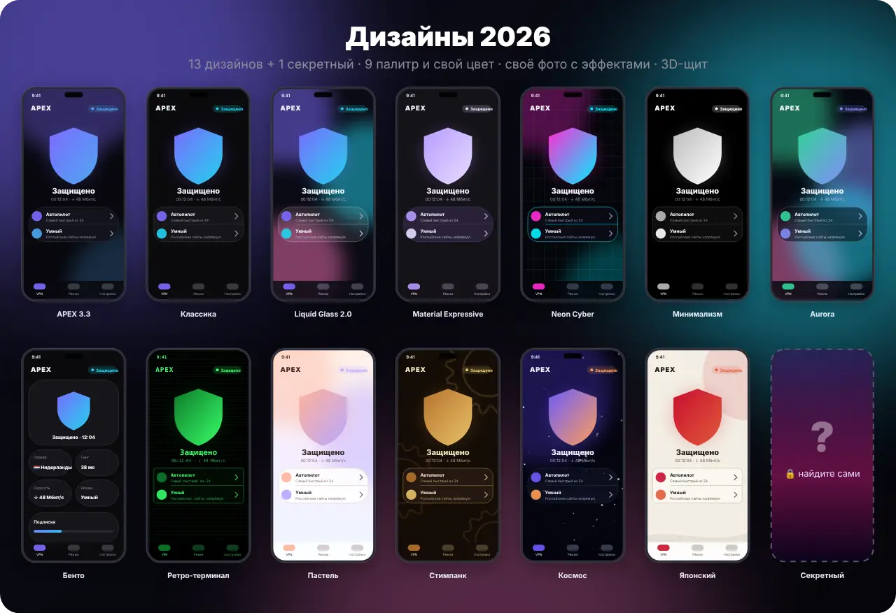
</div>

| Дизайн | Характер |
|---|---|
| **APEX 3.2** ✨ | фирменный облик: крупные карточки, мягкое свечение, цвет — любой; название идёт за версией |
| **Классика** | спокойный тёмный или светлый |
| **Liquid Glass 2.0** | стекло, блик и пятна двигаются при наклоне телефона |
| **Material Expressive** | цвет берётся из обоев (Android 12+) |
| **Neon Cyber** | неоновая сетка, розовый и голубой |
| **Минимализм** | только чёрное и белое |
| **Aurora** | плывущее северное сияние |
| **Бенто** | главный экран из плиток |
| **Ретро-терминал** | зелёный моноширинный шрифт |
| **Пастель** | светлый и мягкий |
| **Стимпанк** | латунь, медь и вращающиеся шестерёнки |
| **Космос** ✨ | звёзды, туманность, планеты и спутник вокруг щита |
| **Японский минимализм** ✨ | рисовая бумага, тушь, красный акцент, шрифт с засечками |
| **???** 🔒 | секретная тема — откройте сами |

Выбирается здесь: **Настройки → Оформление → «Дизайн, тема и иконка»**. Там же **палитры** из двух цветов, **свой цвет** (радужный кружок «Свой»), тема (светлая, тёмная, AMOLED, как в системе), иконка приложения и фон за щитом (для своего фото — размытие, затемнение и движение). Смена идёт «волной» от места нажатия.

<a id="protocols"></a>


Два ядра, как в Happ: **sing-box 1.13.21** и **Xray 26**. Выбор в **Настройки → Ядро**:
- **Авто**: Xray включается только для того, что не умеет sing-box;
- **Только Xray**;
- **Только sing-box**.

| | |
|---|---|
| **VLESS** | Reality, Vision, WS, gRPC, HTTP/2, HTTPUpgrade, QUIC, **XHTTP**, **VLESS Encryption** |
| **VMess · Trojan** | все транспорты, **mKCP** через Xray |
| **Hysteria · Hysteria 2** | со сменой портов и Salamander |
| **TUIC · WireGuard · AnyTLS** | |
| **NaiveProxy · ShadowTLS · SSH** | |
| **SOCKS 4/5 · HTTP(S)** | цепочки серверов (detour) из JSON-подписок |

<details>
<summary>Не поддерживается</summary>

- ShadowsocksR и AmneziaWG: их нет в ядрах.
- Shadowsocks скрыт в приложении.

</details>

<a id="build"></a>


Обычная сборка — через GitHub Actions.

<details>
<summary><b>Локально</b></summary>

Нужны JDK 17, Go 1.25+, Android SDK и NDK `28.0.13004108`.

```bash
export ANDROID_HOME=~/Android/Sdk
./core/build-core.sh                      # ядро → app/libs/libbox.aar
./core/fetch-xray.sh                      # Xray → jniLibs
./gradlew assembleRelease
```

</details>

<details>
<summary><b>Структура проекта</b></summary>

```
app/                    Android-приложение (Kotlin, Jetpack Compose)
  …/vpn/                VpnService, ядра sing-box и Xray, виджеты, ярлыки
  …/data/               подписка, настройки, пинг, звуки, обновление баз
  …/update/             обновление приложения
  …/ui/                 экраны, темы, карта
wear/                   APEX Watch — приложение для часов Wear OS
core/apexcore/          Go: разбор подписки → конфиги sing-box и Xray (+ тесты)
.github/workflows/      сборка APK
```

</details>

<details>
<summary><b>Отчёты о сбоях и приватность</b></summary>

Своего сервера у приложения нет, и оно никуда не отправляет данные само. Ошибки и сбои сохраняются **только на телефоне** (30 дней). Пользователь сам отправляет отчёт кнопкой **Настройки → Написать в поддержку**: в нём модель телефона, версия, настройки и журнал ядра — без ссылки подписки, адресов серверов и IP.

</details>

<a id="whatsnew"></a>


    

### 3.18.0 · 12 ноября 2026


- Управление из веб-админки (для владельца): баннер на главном экране — новости, технические работы, сбои; пользователь может его закрыть
- Пометки серверов из админки: «⭐ Советуем», «🔧 Обслуживание», «🐢 Медленно»; серверы на обслуживании и скрытые автопилот не выбирает
- Из админки: ссылки поддержки и канала, обязательное обновление для старых версий, отзыв плохой версии (приложение предложит вернуться на прошлую)
- Из админки: экстренное выключение функций у всех — автопереход на LTE-обход, список HaGeZi, защита от мошенников, автоустановка обновлений


- Всё это меняется без новой версии приложения: настройки подхватываются при каждом открытии приложения и в фоне раз в 15 минут

#### 📚 Все версии (106)

Каждая версия — отдельная вкладка.

<details>
<summary><b>3.17.11</b> · 12 ноября 2026</summary>


- IP-адреса скрыты точками (185.•••.•••.•••) везде, где приложение их показывает: проверка утечек, тест скорости, журнал соединений — можно спокойно делать скриншоты. Кнопка «Показать IP-адреса» открывает их сразу на всех экранах до закрытия приложения

</details>

<details>
<summary><b>3.17.10</b> · 12 ноября 2026</summary>


- Правила «если — то»: варианты переносятся на новую строку, а не уезжают за край экрана; выбранный вариант теперь хорошо видно
- Готовые правила — «если» и «то» на двух строках, длинные названия больше не обрезаются
- Выбор приложения для правила: поиск, иконки, недавно открытые приложения — сверху; выбранное приложение показывается с иконкой
- Просьба дать доступ к истории использования — отдельной заметной карточкой с кнопкой «Разрешить доступ»

</details>

<details>
<summary><b>3.17.9</b> · 11 ноября 2026</summary>


- Поиск по настройкам: пишете «DNS», «реклама», «обновления» — и сразу переходите к нужному пункту
- «Защита от мошенников» на вкладке «Режим»: фишинг, поддельные банки и вирусные сайты не откроются (список HaGeZi Threat Intelligence, обновляется каждый день)
- Уведомление «VPN отключился», если VPN пропал сам (включили другой VPN, ошибка ядра): с причиной и кнопкой «Подключить снова»
- «Отправить отчёт в Telegram» в окне поддержки — отчёт сразу уходит в Telegram, остаётся выбрать чат
- «Скрыть VPN от приложений»: вся категория одной кнопкой — например, «Скрыть VPN от всех: Банки»
- Ярлык «LTE-обход» при долгом нажатии на иконку приложения (если в подписке есть сервер обхода)
- Кнопки «?» у сложных настроек — FakeDNS, стратегия доменов, WARP, IPv6, аварийный выключатель, серверы с рекламой — с объяснением простыми словами


- Если DNS не отвечал (белые списки, перезагрузка), сервер с доменом терял адрес, и Xray перезапускался с обрывом всех соединений. Теперь берётся прошлый удачный адрес

</details>

<details>
<summary><b>3.17.8</b> · 11 ноября 2026</summary>


- Переключились с ручного сервера на «Автопилот» при включённом VPN — белые списки проверялись только через 5 минут. Теперь сразу

</details>

<details>
<summary><b>3.17.7</b> · 11 ноября 2026</summary>


- «Базы сайтов» разложены по группам: Россия — напрямую, реклама и трекеры, семейный режим
- Маршрутизация: категории сверху — базы сайтов, свои правила, домены, WARP, DNS — показывают только нужный раздел
- «Приложения» (выбор, что идёт через VPN): категории как в «Скрыть VPN» — банки, госуслуги, магазины и т. д., плюс «Выбрано», список по алфавиту
- «Что нового»: фильтр — только новое, улучшения или исправления

</details>

<details>
<summary><b>3.17.6</b> · 11 ноября 2026</summary>


- «Умный» режим: новый список сайтов, которые работают только из России (Госуслуги, банки, магазины — в том числе не на .ru), от runetfreedom. Они всегда идут напрямую, без VPN. Обновляется сам каждый день


- Список HaGeZi не скачивался («нет файла» в «Базах сайтов»), если остальные базы уже были свежими. Теперь он скачивается при проверке баз, а в новых сборках он ещё и встроен в приложение

</details>

<details>
<summary><b>3.17.5</b> · 11 ноября 2026</summary>


- Блокировка рекламы: к основной базе добавлен список HaGeZi Multi Normal — реклама, трекеры, аналитика и вредоносные сайты. Обновляется сам каждый день вместе с остальными базами, в «Маршрутизации → Базы сайтов» видно, сколько в нём записей

</details>

<details>
<summary><b>3.17.4</b> · 11 ноября 2026</summary>


- «Поделиться APEX VPN» (Настройки → О приложении): ссылка на скачивание и короткая инструкция по установке
- «QR-код подписки» (Настройки → Перенос): только ссылка подписки, без настроек — для второго телефона или другого приложения


- Раздача на компьютер: адреса для Wi-Fi и для точки доступа телефона показываются отдельно и обновляются сами, добавлена инструкция для раздачи через точку доступа
- Уведомления о конце подписки (за 3 дня, за день и в день окончания) — с кнопкой «Продлить»: личный кабинет из подписки или чат поддержки

</details>

<details>
<summary><b>3.17.3</b> · 11 ноября 2026</summary>


- LTE-обход выбран вручную, а обычные серверы снова работают (белые списки сняли или вы на Wi-Fi) — придёт уведомление с кнопкой «На автопилот». Ручной выбор само приложение не меняет; не чаще раза в 2 часа


- На LTE-обходе автоматический замер DNS пропускается — не тратит время и лимитный трафик обхода; на странице DNS это написано
- Отчёт для поддержки: одинаковые ошибки журнала — одной строкой с числом повторов, а при копировании журнал обрезается по целым строкам и оставляет самые свежие


- После запуска автопилот проверял Xray-серверы раньше, чем Xray открыл их порты («connection refused» в журнале), и считал их недоступными. Теперь ядро ждёт, пока откроются порты всех серверов

</details>

<details>
<summary><b>3.17.2</b> · 11 ноября 2026</summary>


- При белых списках не открывались российские сайты (например, 2ip.ru): в «Умном» режиме они шли напрямую, а оператор пропускает напрямую только разрешённые. Теперь на LTE-обходе (выбранном вручную или включённом автопилотом) весь трафик идёт через VPN — на главном экране это подписано

</details>

<details>
<summary><b>3.17.1</b> · 11 ноября 2026</summary>


- Отчёт для поддержки показывает, какой сервер на самом деле выбран в ядре, и ошибку Xray, если он остановился


- Бывало, что в приложении выбран сервер (например, LTE-обход), а ядро продолжало идти через автопилот — выбор не действовал. Теперь после подключения и каждой перезагрузки ядро сверяется с выбором и переключается само
- Автопилот «долго думал» при белых списках: сначала шёл замер DNS (при белых списках все DNS молчат — десятки секунд), а проверка белых списков — только после него. Теперь проверка первая, и если настоящий запрос через LTE-обход прошёл, а через обычные серверы нет — обход включается сразу, без второй проверки
- Hysteria 2 из подписки Xray JSON подписывалась как «Hysteria»

</details>

<details>
<summary><b>3.17.0</b> · 11 ноября 2026</summary>


- Подписки в формате Xray JSON (как их получает Happ): серверы подключаются через Xray со всеми настройками из панели — XHTTP с extra, фрагментация (dialerProxy), подписи serverDescription


- Если панель отдаёт Happ и APEX разные адреса серверов (например, «обход» через CDN только в JSON), теперь APEX может получать ту же подписку, что и Happ

</details>

<details>
<summary><b>3.16.3</b> · 11 ноября 2026</summary>


- Отчёт для поддержки показывает адрес выбранного сервера (только первые две части IP или «домен») и порт — проще сравнить с другим приложением


- В отчёте в строке сервера «Xray» повторялось дважды

</details>

<details>
<summary><b>3.16.2</b> · 11 ноября 2026</summary>


- То же исправление касается TCP-пинга серверов и «Подобрать самый быстрый»: при неработающем VPN серверы с доменом больше не показываются «мёртвыми»


- Автопилот не включал LTE-обход при белых списках, если адрес сервера в подписке — домен, а не IP: при включённом, но не работающем VPN имя сервера искалось через сам туннель и не находилось, поэтому все серверы, включая LTE-обход, считались недоступными. Теперь адрес ищется через настоящую сеть (мобильную или Wi-Fi)

</details>

<details>
<summary><b>3.16.1</b> · 11 ноября 2026</summary>


- Белые списки определяются быстрее: при подозрении перепроверка через 15 секунд вместо минуты, а пока обход включён — снятие белых списков проверяется каждые 3 минуты


- Автопилот не находил белые списки у оператора: TCP-пинг до обычных серверов проходил, хотя интернет через них не шёл. Теперь, пока VPN включён, каждый сервер проверяется настоящим запросом в интернет
- Сразу после включения LTE-обхода автопилот мог тут же выключить его обратно (ядро ещё перезагружалось, и проверка ошибалась) — теперь обход снимается только по настоящему замеру
- Правила «если — то»: удалённое или выключенное правило возвращало прежнюю настройку, даже если вы уже поменяли её вручную; отредактированное во время действия правило могло вернуть не то значение
- «Подобрать самый быстрый» при белых списках выбирал из обычных серверов, которые не работают, — теперь из LTE-обхода
- «Пинг через VPN» на медленном LTE-обходе часто показывал «нет ответа»: увеличено время ожидания

</details>

<details>
<summary><b>3.16.0</b> · 9 ноября 2026</summary>


- Адрес подписки теперь задаётся файлом на GitHub (docs/config/subscription.json): при смене домена достаточно поправить файл — приложения подхватят новый адрес сами, без новой версии
- Старые ссылки, приглашения и QR-коды с прежним адресом подписки сами переписываются на новый — путь и токен те же

</details>

<details>
<summary><b>3.15.0</b> · 9 ноября 2026</summary>


- Подписка переехала на sub.knownhosts.xyz: приложение принимает только новые ссылки https://sub.knownhosts.xyz/…, а сохранённая ссылка sub.knownhosts.ru переносится на новый адрес сама — ничего вводить заново не нужно


- Старый адрес sub.knownhosts.ru больше не поддерживается

</details>

<details>
<summary><b>3.14.1</b> · 4 ноября 2026</summary>


- «Цвет пинга»: свои пороги — до скольких мс пинг зелёный и жёлтый. Готовые наборы: Обычный (300/800), Для игр (60/150), Строгий (120/300), Мягкий (500/1500). Цвета меняются везде: список серверов, главная, виджеты

</details>

<details>
<summary><b>3.14.0</b> · 4 ноября 2026</summary>


- «Пинг»: кнопка «Проверить сейчас» — текущий сервер выбранным способом, результат сразу на экране
- «Сравнить способы»: тот же сервер проверяется TCP, GET, HEAD и ICMP — видно, какой способ что показывает


- Тайм-аут: под ползунком больше нет дубля «15 сек · 15 сек»; подсказка, что 5–8 сек — оптимально, и кнопка «Поставить 6 сек», если стоит больше 8

</details>

<details>
<summary><b>3.13.7</b> · 4 ноября 2026</summary>


- «О приложении»: строка об авторских правах © 2026 Dubstep2004

</details>

<details>
<summary><b>3.13.6</b> · 3 ноября 2026</summary>


- Шаблон «Скрыть VPN» скачивается не чаще раза в 12 часов, а не каждый час


- «Помощник» путал секунды и миллисекунды в сроке подписки: на «VPN не подключается» всегда говорил «Подписка закончилась», а на «Когда кончится подписка» показывал неверную дату
- Правила «если — то»: если удалить все правила, пока одно из них действует, изменённая им настройка не возвращалась
- Настройка, изменённая в фоне (правило или шаблон «Скрыть VPN»), и изменение на экране в тот же момент могли затереть друг друга

</details>

<details>
<summary><b>3.13.5</b> · 3 ноября 2026</summary>


- Android 16: переключатель «Живое уведомление» в настройках уведомлений


- «Сервисы на серверах»: страна сервера и когда проверено; если сервис официально не работает в стране сервера (например, ChatGPT в России), «работает» больше не показывается по ошибке
- «Обновить часы»: если часы не ответили за 90 секунд — подсказка, что сделать на часах
- Правила «если — то»: если Android отключил доступ к истории использования, приходит уведомление (не чаще раза в сутки)


- Карточка подписки: для бессрочной безлимитной подписки панель писала «Истекает: 26538» и «Осталось ГБ: 0» — теперь «Истекает: никогда» и «Осталось: безлимит»
- Значок питания на щите стал ярче — на тёмном стекле он терялся
- Разделители в карточках: одинаковые отступы слева и справа

</details>

<details>
<summary><b>3.13.4</b> · 3 ноября 2026</summary>


- Стеклянные карточки со свечением («Свой дизайн», «Матрица»): внутри был виден тёмный сдвинутый прямоугольник — тень просвечивала сквозь стекло. Теперь вместо тени светится рамка

</details>

<details>
<summary><b>3.13.3</b> · 3 ноября 2026</summary>


- Светлый основной цвет (жёлтый, золото, белый, салатовый, неоновый): текст на кнопках и выбранных вкладках был белым по светлому — теперь тёмный и читается
- «Настройки» с выбранной категорией: последний пункт прижимался к нижней панели — вернули отступ
- «Сакура» и «Матрица» с сезонным оформлением: поверх своих лепестков и символов летели ещё и осенние листья

</details>

<details>
<summary><b>3.13.2</b> · 3 ноября 2026</summary>


- Дизайны разложены по категориям: Фирменные · Стекло и неон · Живые · Светлые · Премиум · Свой — фильтр сверху и группы с заголовками


- «Свой дизайн» со стеклом: вместо жёстких кругов на фоне — мягкие размытые пятна; разделители, полоса трафика, выбранная вкладка и щит больше не становятся белыми (текст на них снова видно)

</details>

<details>
<summary><b>3.13.1</b> · 3 ноября 2026</summary>


- Оформление: фон главного экрана теперь в одном разделе — готовые фоны, живое видео, а «Своё фото» и «Своё видео» рядом, одной группой

</details>

<details>
<summary><b>3.13.0</b> · 3 ноября 2026</summary>


- Пять новых дизайнов: «Карбон» (графит и углеволокно), «Сакура» (падающие лепестки), «Матрица» (зелёный дождь символов), «Люкс» (чёрный и золото), «Океан» (живые волны)
- «Свой дизайн»: выберите цвет фона, основной и второй цвет, скругление карточек, стекло, рамку и неоновое свечение — изменения видны сразу (Оформление → «Свой дизайн»)

</details>

<details>
<summary><b>3.12.0</b> · 3 ноября 2026</summary>


- «Скрыть VPN»: приложения разложены по категориям — банки и платежи, госуслуги, маркетплейсы, Яндекс, VK и Mail.ru, операторы, такси и доставка, видео и музыка, карты и поездки, мессенджеры, игры. Фильтр сверху, «Скрыто», и кнопка «Скрыть все» у каждой категории
- Категории в «Настройках»: Все · Подключение · Инструменты · Вид и звук · Подписка · Обновления · Данные · О приложении

</details>

<details>
<summary><b>3.11.3</b> · 3 ноября 2026</summary>


- Помощник: кнопки в ответах и подсказки внизу стали крупнее — удобно нажимать пальцем


- Поле ввода в «Помощнике» и низ страниц со списками («Скрыть VPN», «Приложение не работает?») уходили под кнопки навигации Android и клавиатуру

</details>

<details>
<summary><b>3.11.2</b> · 3 ноября 2026</summary>


- Сезонное оформление не рисуется в режиме энергосбережения


- «Приложение не работает?» → «Вернуть через VPN»: автообновление шаблона «Скрыть VPN» через час добавляло приложение обратно — теперь помнит ваш выбор
- Автообновление шаблона раз в час загружало значки всех приложений — лишняя память и батарея; теперь только названия
- Android 16: в капсуле статус-бара «застывала» скорость 0 Б/с, если скорость в уведомлении выключена — теперь там «VPN»
- Отменённое или неудачное обновление могло потом само открыть приложение после следующего фонового обновления

</details>

<details>
<summary><b>3.11.1</b> · 3 ноября 2026</summary>


- «Обновлять шаблон автоматически» в «Скрыть VPN» теперь включено у всех по умолчанию: список приложений, которые проверяют VPN, обновляется сам, а новые приложения из него добавляются автоматически. Выключить можно там же

</details>

<details>
<summary><b>3.11.0</b> · 3 ноября 2026</summary>


- Правила «если — то»: «если открыто приложение / идёт зарядка / мобильный интернет / Wi-Fi / время» → «режим автопилота, сервер, маршрут, блокировка рекламы, обновить базы сайтов или выключить VPN». Условие прошло — настройка возвращается как была. Есть готовые правила (Настройки → «Правила „если — то“»)

</details>

<details>
<summary><b>3.10.0</b> · 3 ноября 2026</summary>


- «Помощник» — чат с подсказками: «не работает YouTube», «медленно», «банк не открывается», «подписка». Отвечает по состоянию VPN, подписке, журналу соединений и правилам маршрута, с кнопками «сделать». Без интернета; это не ИИ
- Шаблон «Скрыть VPN» обновляется сам: список приложений, которые проверяют VPN, приходит из интернета раз в сутки, а новые приложения из шаблона добавляются автоматически (переключатель «Обновлять шаблон автоматически»; убранные вручную не возвращаются)


- В шаблон добавлены приложения из списков СМИ 2026 года: Парковки России, Магнит, Дзен, Кинопоиск, ivi, Яндекс Go и Пэй, Домклик, Госключ, Мос.ру, банки МТС, Почта, Совкомбанк, Росбанк, Райффайзен и другие

</details>

<details>
<summary><b>3.9.1</b> · 3 ноября 2026</summary>


- Скачанный файл обновления удаляется сразу после установки


- В окне обновления были видны звёздочки разметки («**Новое**») — теперь обычный текст
- После нажатия «Обновить» в окне Android кнопка снова становилась активной, будто ничего не происходит, — теперь «Установка…» с полосой
- После обновления приложение просто закрывалось — теперь открывается снова само (или приходит уведомление «APEX VPN обновлён — открыть»)

</details>

<details>
<summary><b>3.9.0</b> · 2 ноября 2026</summary>


- Android TV: подписку можно прислать с телефона — телевизор показывает QR-код, телефон открывает страницу и вставляет ссылку. Пультом печатать не нужно
- Android 16: «живое» уведомление VPN — капсула со скоростью в строке состояния (где оболочка это поддерживает)


- Плитка APEX Watch в стиле Wear OS 6: кольцо состояния, крупный статус, плашка сервера (открывает приложение) и широкая кнопка «Включить / Выключить»

</details>

<details>
<summary><b>3.8.0</b> · 2 ноября 2026</summary>


- Сезонное оформление: зимой снег, весной лепестки, летом светлячки, осенью листья — выключается в «Оформлении»
- Резервная копия с паролем: файл шифруется (AES-256), без пароля его не прочитать; при восстановлении приложение само спросит пароль
- «Автопилот только по избранным»: выбирать только среди серверов со звёздочкой (Режим → Автопилот)

</details>

<details>
<summary><b>3.7.1</b> · 2 ноября 2026</summary>


- «Пробовать новое раньше» теперь называется «Бета-версии» (Настройки → Обновления)

</details>

<details>
<summary><b>3.7.0</b> · 2 ноября 2026</summary>


- «Пробовать новое раньше» — тестовый канал: приходят и тестовые версии (на GitHub — Pre-release), обновляются в один клик
- «Вернуть прошлую версию»: по шагам — копия настроек, файл прошлой версии с GitHub (с проверкой SHA-256), удаление и установка. Android не ставит старую версию поверх новой, поэтому иначе нельзя
- Обновление часов APEX Watch с телефона: телефон скачивает версию для часов, сверяет SHA-256 и передаёт на часы, часы предлагают установить

</details>

<details>
<summary><b>3.6.0</b> · 2 ноября 2026</summary>


- Отчёт за месяц: трафик через VPN, время с VPN, подключения, заблокированная реклама, средний пинг и любимые серверы; 1-го числа — уведомление с итогами (Настройки → «Отчёт за месяц»). Всё хранится только на телефоне
- Семейный режим по расписанию: дни недели и время, например будни 8:00–21:00 или ночь 20:00–07:00 — включается и выключается сам (DNS → «Семейный режим по расписанию»)

</details>

<details>
<summary><b>3.5.0</b> · 2 ноября 2026</summary>


- «Приложение не работает?» — кнопка прямо в уведомлении VPN: выберите приложение (недавно открытые — первыми), и оно пойдёт мимо VPN. Банк, госуслуги, маркетплейс — за два нажатия
- Сервисы на серверах: где открываются ChatGPT, YouTube Premium, Netflix и Gemini — ✅/❌ по каждому серверу и фильтр «Где работает…». Проверка идёт через сам сервер, переключаться не нужно

</details>

<details>
<summary><b>3.4.0</b> · 2 ноября 2026</summary>


- Обновление в один клик: кнопка «Обновить» сама скачивает новую версию с GitHub (с докачкой), сверяет SHA-256 и подпись и открывает установку — настройки и подписка сохраняются, VPN включается снова сам
- «Ставить само»: обновление скачивается заранее и ставится, когда VPN выключен или экран погас; на Android 12+ — без вопроса, если прошлую версию поставил сам APEX
- «Скачивать только по Wi-Fi» и ход загрузки в уведомлении: «Загрузка обновления 45%»


- Уведомление «Доступна версия» сразу запускает обновление, а не открывает браузер


- Версия для Windows больше не развивается и убрана из описания

</details>

<details>
<summary><b>3.3.2</b> · 2 ноября 2026</summary>


- Интервал автообновления подписки из старой резервной копии или прежних версий мог быть 0 или 48 ч — теперь всегда 1, 6, 12 или 24 ч
- Живое видео на фоне: при каждом повороте экрана и сворачивании оставался неосвобождённый видеобуфер

</details>

<details>
<summary><b>3.3.1</b> · 2 ноября 2026</summary>


- Звук подключения включён по умолчанию у новых установок (Настройки → Оформление → «Звук подключения»)


- Не было звука подключения: звук шёл как «системный» (его громкость на многих телефонах — 0) и в статическом режиме, который на части телефонов молчит. Теперь — громкость уведомлений и потоковый режим
- Звук отключения иногда пропадал, если VPN выключался быстро

</details>

<details>
<summary><b>3.3.0</b> · 2 ноября 2026</summary>


- Живое видео на фоне главного экрана: 6 готовых шаблонов (Сияние, Космос, Жидкое стекло, Синтвейв, Океан, Ночной дождь) или своё видео из галереи — без звука, по кругу, с затемнением
- «Скрыть VPN»: готовый шаблон «Российские приложения» — одним нажатием Яндекс, VK, Max, Госуслуги, банки, маркетплейсы, операторы и другие, что проверяют VPN (из тех, что у вас установлены)
- Автообновление подписки раз в 1 час


- Скорость серверов через Xray (XHTTP, mKCP и режим «Только Xray»): Xray выходит в сеть напрямую через ядро, а не второй раз через туннель VPN — меньше нагрузки и задержки
- DNS «Авто»: замеры идут по два, а не все 12 разом через один сервер — время ответа больше не завышается; видно, мерилось через VPN или напрямую


- Тест скорости: «Провайдер не определён» — теперь есть запасные способы узнать провайдера и узел (ipwho.is, ipinfo.io, ip.sb, trace Cloudflare)
- Подписка не обновлялась сама: фоновая проверка теперь раз в час, а пока VPN включён — ещё и в самом VPN каждые 5 минут; интервал из панели больше не подменяет выбранный в настройках
- Справка: «Сервер под задачу» заменён на «Режимы автопилота», обновлена картинка теста скорости
- Журнал соединений не показывает служебные соединения ядра (замеры и выход Xray)


- Пункт «Приложения» в настройках: список «Кроме выбранных» перенесён в «Скрыть VPN», режим «Только выбранные» убран — через VPN снова весь телефон

</details>

<details>
<summary><b>3.2.1</b> · 29 октября 2026</summary>


- Поддержка в Telegram — @Apexx_support: на странице «О приложении» (нажмите, чтобы открыть чат) и в «Написать в поддержку»

</details>

<details>
<summary><b>3.2.0</b> · 29 октября 2026</summary>


- Тест скорости 3.0: большая кнопка «Начать» по центру спидометра, как в Speedtest
- Провайдер и сервер теста видны до начала: название провайдера, IP, город и узел Cloudflare
- Единицы: Мбит/с, МБ/с или КБ/с
- Масштаб спидометра: 100, 500 или 1000
- Тип соединения: множественное (4 потока — вся ширина канала) или одинарное (как качает браузер)
- Джиттер — насколько ровный пинг


- Пинг в тесте меряется точнее: 8 запросов, первый (с установкой соединения) не считается

</details>

<details>
<summary><b>3.1.2</b> · 29 октября 2026</summary>


- Можно выбрать, как часто обновлять базы сайтов: каждые 6 часов, 12 часов, каждый день или раз в неделю


- «Автообновление баз» теперь прямо в Настройках, под «Обновить базы сайтов», а не только в «Маршрутизации»

</details>

<details>
<summary><b>3.1.1</b> · 29 октября 2026</summary>


- Проверка DNS-утечек могла показать старый результат из кэша — теперь каждый раз свой адрес проверки
- После поворота экрана приложение снова спрашивало про ту же ссылку («Добавить подписку?», «Сайт …»)
- Цвета темы больше не пересчитываются при каждом обновлении подписки — меньше лишней работы

</details>

<details>
<summary><b>3.1.0</b> · 29 октября 2026</summary>


- Проверка утечек: видят ли сайты ваш настоящий IP — IP через VPN и без, DNS, IPv6 и WebRTC (Настройки → Инструменты)
- Щит в цветах режима автопилота: 🎮 Игры — красный пульс, 🚀 Скорость — голубые полосы, 🛡 Надёжный — ровное кольцо, 📞 Звонки — звуковые волны, 🔋 Батарея — «дыхание»
- «Поделиться» ссылкой на сайт из браузера → APEX VPN: выберите «Через VPN» или «Напрямую» — сайт сразу в списке
- Сайты стран напрямую: Казахстан, Беларусь, Узбекистан, Киргизия, Армения, Азербайджан, Грузия, Таджикистан, Молдова, Турция — домен страны и её банки и сервисы мимо VPN (Режим)
- Журнал соединений: какие сайты шли через VPN, какие напрямую, что заблокировано — с поиском и фильтрами, только на телефоне, стирается через сутки
- Приветствие по времени суток: «Доброе утро! Защищено ✓»
- При удалении подписки можно удалить и все данные: настройки, списки, журналы, замеры, фото

</details>

<details>
<summary><b>3.0.1</b> · 29 октября 2026</summary>


- Если в «Пинге» выбран ICMP, а оператор его не пропускает, белые списки могли зря включить LTE-обход, а режимы автопилота — посчитать серверы «мёртвыми». Служебные проверки теперь всегда меряют по TCP
- Выбор режима автопилота и фоновый подбор больше не запускаются одновременно и не переключают серверы друг другу
- При белых списках ядро больше не перезагружается каждые 15 минут из-за режима автопилота
- Старая задача «Видео» больше не закрепляет сервер вручную — она стала режимом «Скорость»
- Пинг в списке серверов подсвечивается только после перепроверки, а не при каждом открытии списка

</details>

<details>
<summary><b>3.0.0</b> · 29 октября 2026</summary>


- Режимы автопилота: ⚖️ Обычный, 🎮 Игры, 🚀 Скорость, 🛡 Надёжный, 📞 Звонки и 🔋 Батарея — прямо в списке серверов и в «Профиле подключения»
- 🎮 Игры: каждый сервер проверяется 4 раза подряд, автопилот выбирает только из серверов с низким и ровным пингом (маленький джиттер) и без потерь
- 🚀 Скорость: APEX измеряет скорость загрузки через 3 лучших сервера и оставляет автопилоту 2 самых быстрых. Сервер не закрепляется — при сбое автопилот переключится сам
- 🛡 Надёжный: только серверы без потерь, которые ни разу не пропадали, — сервер не меняется без нужды
- В режимах «Игры» и «Скорость» у серверов видно джиттер, потери и скорость в Мбит/с


- Подбор серверов повторяется раз в 15 минут (скорость — раз в 30), ядро перезагружается только если подходящие серверы изменились


- «Для чего VPN сейчас» (Игры, Видео, Звонки) теперь режимы автопилота; «Видео» стало «Скоростью»

</details>

<details>
<summary><b>2.9.0</b> · 29 октября 2026</summary>


- Настройки пинга: Настройки → Инструменты → «Пинг»
- Тип пинга: TCP до сервера, через прокси GET или HEAD (запрос к сайту через каждый сервер) и ICMP
- Режим пинга через прокси: Обычный, Double и KeepAlive — берётся лучший из двух запросов
- Тайм-аут пинга через прокси от 5 до 15 секунд
- Свой адрес проверки (URL-тест) — его используют и пинг, и автопилот
- Результат пинга: время, столбики сигнала или вместе

</details>

<details>
<summary><b>2.8.3</b> · 29 октября 2026</summary>


- Если сервер нельзя проверить напрямую (белые списки, mKCP), пинг берётся из проверки через ядро


- Пинг в списке серверов был в 2–3 раза больше настоящего: под VPN показывалась полная проверка через сервер (подключение, шифрование и запрос к сайту). Теперь это время до самого сервера — одно «туда-обратно», как в других клиентах, и с VPN, и без

</details>

<details>
<summary><b>2.8.2</b> · 29 октября 2026</summary>


- Плашка с пингом у сервера на главном экране — пинг виден в графике «Пинг через VPN» и в списке серверов

</details>

<details>
<summary><b>2.8.1</b> · 29 октября 2026</summary>


- Главная причина многих сбоев: Android запрещал приложению обращаться к своему же ядру на телефоне. Из-за этого не работали пинг через сервер в списке, «Сейчас: …» и метка «Автопилот», переключение сервера при подборе самого быстрого, трафик по приложениям и проверка сайтов через ядро
- Пинг у сервера на главном экране теперь такой же, как у этого сервера в списке серверов

</details>

<details>
<summary><b>2.8.0</b> · 29 октября 2026</summary>


- Нажмите на пинг сервера в списке — он перепроверится прямо на месте: крутится индикатор, новый пинг «вспыхивает», а список сразу пересортируется
- Метка «Автопилот» у сервера, который автопилот выбрал сейчас
- Автопилот в списке серверов пишет, где он сейчас и в какой сети: «Сейчас Швеция · Wi-Fi»


- На Wi-Fi серверы LTE-обхода показывают «только мобильный» вместо «нет ответа» — это не поломка


- Перепроверка одного сервера не стирает сохранённые замеры остальных

</details>

<details>
<summary><b>2.7.1</b> · 29 октября 2026</summary>


- Пинг сервера на главном экране: плашка со столбиками сигнала и миллисекундами рядом с сервером. Под VPN — живой замер через сервер, без VPN — последний замер

</details>

<details>
<summary><b>2.7.0</b> · 29 октября 2026</summary>


- Автопилот показывает, какой сервер он выбрал прямо сейчас, и его пинг — на главном экране и в списке серверов
- Когда включены белые списки, автопилот так и пишет: «Белые списки · обход LTE»
- В списке серверов — сколько трафика осталось по подписке и подсказка, когда выбирать LTE-серверы


- Пояснение к «Особым» серверам: Россия — для российских сайтов из-за границы, обход и LTE — только для мобильного интернета с белыми списками


- DNS «Авто» показывал «нет ответа» у всех DNS на мобильной сети с белыми списками. Теперь DNS проверяются через сервер VPN — так же, как они и работают
- Если ни один DNS не ответил, «Авто» не меняет DNS и объясняет, что случилось

</details>

<details>
<summary><b>2.6.1</b> · 29 октября 2026</summary>


- Карточка APEX VPN в настройках открывает страницу «О приложении», отдельная строка-дубль убрана

</details>

<details>
<summary><b>2.6.0</b> · 29 октября 2026</summary>


- Раздел «Надёжность» в настройках: защита без перерывов, батарея, подключение при открытии и самопроверка
- «Чтобы VPN не отключался»: разрешение работать без ограничений батареи одним нажатием, переход к автозапуску и инструкции для Xiaomi, Samsung, Honor, OPPO, vivo
- «Подключать при открытии»: VPN включается, как только вы открыли приложение
- «Не работает?»: самопроверка — интернет, подписка, серверы, VPN и сайты — с советом и кнопкой «Выбрать рабочий сервер»
- Карточка «Все серверы работают» / «Работают N из M» — нажмите, чтобы проверить заново
- Страница «О приложении»: конфиденциальность, исходный код этой версии и лицензии открытых проектов


- Переключатель «Отчёты об ошибках» теперь работает: выключен — отчёты о сбоях не сохраняются

</details>

<details>
<summary><b>2.5.4</b> · 29 октября 2026</summary>


- Настройка «QUIC (HTTP/3)» в Профиле подключения: выкл. на мобильной, всегда выкл. или не трогать


- Медленные сайты на LTE: на мобильной сети QUIC (HTTP/3) выключается, и сайты идут по TCP — через VPN так быстрее и стабильнее. На Wi-Fi всё как раньше
- Белые списки больше не включают LTE-обход из-за одного неудачного замера на медленном LTE — нужно подтверждение второй проверкой
- DNS «Авто» на мобильной сети не выбирает DoQ (UDP), только DoH и DoT по TCP
- Пинг на главном экране больше не влияет на выбор сервера автопилотом

</details>

<details>
<summary><b>2.5.3</b> · 29 октября 2026</summary>


- «Автопилот без России и LTE» и «Белые списки» переключаются нажатием на всю строку


- Подписи к настройкам больше не обрезаются «…» на второй строке — видно весь текст
- Между текстом и переключателем появился отступ, текст не прилипает к переключателю
- Подпись «Сейчас включён LTE-обход» появляется сразу, без повторного открытия экрана

</details>

<details>
<summary><b>2.5.2</b> · 29 октября 2026</summary>


- «Пинг через VPN» на главном экране показывал «нет ответа», хотя сервер работал (например, LTE-обход). Теперь пинг меряется внутри ядра — так же, как в списке серверов

</details>

<details>
<summary><b>2.5.1</b> · 29 октября 2026</summary>


- Базы сайтов: два обновления одновременно (фон и кнопка) больше не портят файлы
- Базы сайтов заменяются целиком за один шаг — ядро не прочитает недописанный файл
- DNS «Авто»: после смены сети нужный DNS применяется сразу, а не со следующей проверки
- Белые списки: если снова включить переключатель, проверка начинается сразу, без переподключения
- Миниатюры дизайнов показывают цвета выбранной палитры
- После отключения VPN не остаётся старых данных о сети

</details>

<details>
<summary><b>2.5.0</b> · 29 октября 2026</summary>


- Базы сайтов обновляются каждый день: свежие базы российских сайтов, рекламы и семейного режима публикуются на GitHub APEX VPN автоматически
- Качаются только изменившиеся базы — проверка почти не тратит трафик
- Если GitHub недоступен, базы берутся с зеркала jsDelivr или с официального сервера sing-box
- Автообновление баз можно выключить: Настройки → Маршрутизация → «Автообновление баз»


- В «Маршрутизации» видно, от какого числа базы, откуда скачаны, когда проверялись и сколько в каждой записей
- Каждая новая версия приложения сразу содержит свежие базы
- Базы проверяются и после подключения VPN, если телефон долго не запускал фоновые задачи

</details>

<details>
<summary><b>2.4.0</b> · 29 октября 2026</summary>


- Белые списки: если на мобильной сети обычные серверы не отвечают, а LTE-обход работает — автопилот сам переходит на обход LTE и пишет об этом. Выключается в Настройки → Профиль
- DNS «Авто» запоминает лучший DNS для каждой сети: свой для домашнего Wi-Fi, работы и мобильной связи — и сразу ставит его при смене сети
- DNS «Авто» проверяет не только DoH, но и DoT и DoQ — Cloudflare, Google, Quad9, Mullvad (DoT) и Control D (DoT и DoQ)
- Своё фото на главном экране: размытие, затемнение и движение при наклоне телефона
- Готовые палитры из двух цветов: Закат, Мята, Лаванда, Кофе, Океан, Вишня, Лайм, Золото и Полночь


- В настройках DNS видно, для какой сети выбран DNS и по какому протоколу

</details>

<details>
<summary><b>2.3.1</b> · 28 октября 2026</summary>


- Ещё 6 DNS: Mullvad, OpenDNS, Control D, NextDNS, Яндекс DNS и Comss.one (открывает ИИ-сервисы)


- DNS «Авто» выбирает из 6 серверов: Cloudflare, Google, Quad9, Mullvad, OpenDNS и Control D
- В настройках видно, какой DNS сейчас выбрал «Авто»


- 3D-щит и блики стекла больше не «завалены» в покое — наклон считается от привычного положения телефона
- Подбор самого быстрого сервера, как и автопилот, не выбирает серверы России и LTE-обхода
- Объявление из панели только с картинкой или только с кнопкой теперь показывается
- «Очистить данные» сбрасывает и сохранённые замеры пинга и выбор DNS
- APEX Watch: кнопка «Назад» в списке серверов возвращает на главный экран, а не закрывает приложение
- APEX Watch: плитка использует стабильный способ ответа системе

</details>

<details>
<summary><b>2.3.0</b> · 28 октября 2026</summary>


- DNS «Авто»: приложение само выбирает самый быстрый — Cloudflare, Google или Quad9 (Настройки → DNS)
- APEX Watch: выбор сервера прямо с часов
- APEX Watch: плитка — состояние, сервер и большая кнопка включения
- APEX Watch: значок на циферблат — щит и пинг
- APEX Watch: часы коротко вибрируют, если VPN отключился
- Трафик по приложениям: кто сколько потратил через VPN — сегодня и за 7 дней (Android 10+)
- Справка в приложении: инструкции с картинками — Настройки → О приложении → Справка
- Автоматизация: Tasker и MacroDroid могут включать, выключать VPN и менять сервер
- 3D-щит поворачивается, когда вы наклоняете телефон
- Тема «Космос»: звёзды, туманность и планеты со спутником вокруг щита
- Тема «Японский минимализм»: рисовая бумага, тушь, красный акцент и шрифт с засечками
- При смене сервера по глобусу и карте летит самолётик — от старой страны к новой
- Объявления из панели с картинкой и кнопкой


- Стабильный автопилот: не выбирает серверы России и обход LTE, меняет сервер только если другой заметно быстрее и не обрывает видео и загрузки при смене
- Автопилот при подключении сразу берёт сервер, который был быстрее при прошлом замере, а не первый в списке


- Фирменный дизайн теперь называется по версии приложения — «APEX 2.3», и в заставке тоже

</details>

<details>
<summary><b>2.2.3</b> · 28 октября 2026</summary>


- Если APEX Watch всё же открыли на телефоне — он подскажет, какой файл нужен для телефона
- На странице версии подписано, какой файл для телефона, а какой — только для часов


- APEX Watch больше нельзя по ошибке установить на телефон поверх APEX VPN: Android откажет в установке

</details>

<details>
<summary><b>2.2.2</b> · 28 октября 2026</summary>


- Настройки → О приложении: ссылка на наш GitHub
- APEX Watch: кнопка «GitHub» — ссылка открывается на телефоне; список на часах листается колёсиком

</details>

<details>
<summary><b>2.2.1</b> · 28 октября 2026</summary>


- Приложение для часов теперь называется «APEX Watch» и получило свою иконку: циферблат и щит
- Файл для часов на странице версии: apex-watch-<версия>.apk

</details>

<details>
<summary><b>2.2.0</b> · 28 октября 2026</summary>


- Защита от подделок: приложение проверяет свою подпись и узнаёт перепакованные копии
- Неофициальная копия при каждом запуске предупреждает и даёт ссылку на оригинал; красная плашка на главном и в уведомлении
- «Настройки → О приложении»: «✓ Официальная сборка» у оригинала
- В отчёте для поддержки видно, официальная ли сборка


- Сборка на GitHub не выпустит релиз, подписанный не ключом автора


- Название и логотип APEX VPN не передаются по GPL — правила для форков в TRADEMARKS.md

</details>

<details>
<summary><b>2.1.1</b> · 28 октября 2026</summary>


- Liquid Glass 2.0: датчик наклона работает только пока приложение открыто — меньше расход батареи
- 3D-глобус рисуется экономнее — плавнее и меньше нагружает телефон


- Смена дизайна, темы или цвета «волной» могла закрыть приложение — исправлено
- Конфетти иногда застывало на экране и не исчезало
- У тех, кто обновился, конфетти «Первое подключение» больше не появляется по ошибке
- Восстановление из файла или QR с той же подпиской теперь возвращает и выбранный сервер
- Кнопка «Остановить» останавливает и подбор сервера, который запустился сам после подключения
- «Волна» при смене оформления перекрашивает и фон, а не только карточки

</details>

<details>
<summary><b>2.1.0</b> · 28 октября 2026</summary>


- Знакомство при первом запуске: три экрана с анимацией — щит, маршрутизация и глобус
- Главный экран «Глобус»: вращающийся 3D-шар из точек поворачивается к стране сервера
- Фон «Фото страны»: каждый день новое фото города страны сервера из Википедии
- Liquid Glass 2.0: по стеклу карточек скользит блик, фон смещается при наклоне телефона
- Новый дизайн «Стимпанк»: латунь, медь и вращающиеся шестерёнки
- Смена темы «волной»: новые цвета растекаются кругом от места нажатия
- Флаг переворачивается, как карточка, при смене страны
- Конфетти на первом подключении и юбилейных — 10, 50, 100…
- Значки в настройках «оживают» при открытии
- «Скрыть VPN от приложений»: свой список приложений, которые идут мимо VPN
- «Очистить данные»: всё, кроме подписки, одной кнопкой
- Android TV 2.0: глобус, крупный щит и страны большими карточками для пульта
- Живая иконка на системной заставке Android 12+
- Пасхалка: секретная тема — найдите сами 😉

</details>

<details>
<summary><b>2.0.0</b> · 28 октября 2026</summary>


- Новый дизайн «APEX 2.0»: крупные карточки и строки, мягкое свечение фона
- Вкладки плавно выезжают в сторону нажатой, выделение в нижнем меню переезжает, значок подпрыгивает
- Свой цвет акцента: любой оттенок, насыщенность и яркость, плюс быстрые образцы
- Заставка 2.0: щит рисуется линией, заливается градиентом, затем по буквам появляется «APEX VPN 2.0»
- Сервер под задачу: «Игры» — минимальный пинг, «Видео» — самый быстрый сервер, «Звонки» — стабильная связь
- Подбор самого быстрого сервера: APEX меряет скорость 5 лучших серверов и закрепляет быстрый
- Тест скорости 2.0: спидометр со стрелкой и история последних замеров
- Перенос на новый телефон одним QR-кодом: настройки, свои списки, избранное и подписка
- 5 новых наборов звуков: Космос, Ретро 8-бит, Капля, Арфа, Пульс
- Звук отключения VPN из того же набора


- Уведомления о конце подписки приходят точно за 3 дня, за 1 день и в день окончания — даже без интернета

</details>

<details>
<summary><b>1.9.6</b> · 28 октября 2026</summary>


- Готовые шаблоны своих списков: Игры, Нейросети, Работа, Разработка, Учёба, Кино, Музыка, Соцсети, Покупки
- Несколько шаблонов можно добавить разом, а любой — сначала открыть и изменить

</details>

<details>
<summary><b>1.9.5</b> · 28 октября 2026</summary>


- С фото за щитом на главном экране не тратится батарея на невидимую анимацию


- После восстановления из файла возвращается и выбранный сервер, а не автопилот
- Сохранение настроек в файл работает и в папках, которые не поддерживают перезапись
- Виджет 4×2 подсвечивает выбранную страну, даже если выбран другой сервер этой страны

</details>

<details>
<summary><b>1.9.4</b> · 28 октября 2026</summary>


- Резервная копия настроек в файл и восстановление: Настройки → Резервная копия
- Настройки и подписка попадают в резервную копию Android и возвращаются после переустановки


- Одна ошибка в сохранённых настройках больше не сбрасывает все настройки

</details>

<details>
<summary><b>1.9.3</b> · 28 октября 2026</summary>


- Цветные метки в «Что нового»: Новое, Улучшено, Изменено, Исправлено, Удалено


- Вся история версий размечена по видам изменений


- Описание новых версий на GitHub — с теми же метками

</details>

<details>
<summary><b>1.9.2</b> · 28 октября 2026</summary>


- Обновление подписки могло стереть всё избранное
- Свайп по щиту и виджет 4×2 не видели избранные серверы
- «Ссылка-приглашение» без подписки показывает подсказку вместо пустой ссылки

</details>

<details>
<summary><b>1.9.1</b> · 28 октября 2026</summary>


- Новые сервисы «Через VPN»: Netflix, Spotify, SoundCloud, Reddit, LinkedIn, Pinterest, Snapchat, Signal, Viber, Medium, Patreon, Perplexity, Copilot, Notion, Figma
- Свои списки: создайте список сайтов («Работа», «Игры»), включайте, меняйте и удаляйте


- «Проверить сайт» показывает, в каком своём списке сайт

</details>

<details>
<summary><b>1.9.0</b> · 28 октября 2026</summary>


- Обратный отсчёт до конца подписки: «Осталось 12 дней 4 ч»
- Своё фото из галереи на главный экран («Оформление → Фон за щитом»)
- Новые иконки: Космос, Минимал, Градиент
- Анимация «тоннель» при подключении и «щит закрывается» при отключении
- Избранное само очищается от серверов, которых больше нет в подписке
- Счётчик заблокированной рекламы за день на главном экране
- Ссылка-приглашение: установка приложения и подписка в одно касание

</details>

<details>
<summary><b>1.8.2</b> · 28 октября 2026</summary>


- Живое название APEX VPN: блик по буквам, переливающееся «VPN» и «дышащий» логотип


- «Написать в поддержку»: скопировать отчёт, открыть чат поддержки из подписки или отправить файл

</details>

<details>
<summary><b>1.8.1</b> · 28 октября 2026</summary>


- Объявление из Remnawave снова внизу — в карточке подписки, как раньше

</details>

<details>
<summary><b>1.8.0</b> · 28 октября 2026</summary>


- Работает без своего сервера: обновления — с GitHub, объявления — из Remnawave
- Отчёты о сбоях хранятся на телефоне и попадают в «Написать в поддержку» — приложение ничего не отправляет само

</details>

<details>
<summary><b>1.7.6</b> · 28 октября 2026</summary>


- Адрес сервера больше не вшит в приложение: объявления — из Remnawave, свой сервер — по желанию

</details>

<details>
<summary><b>1.7.5</b> · 28 октября 2026</summary>


- Объявления из панели Remnawave — баннером вверху главного экрана, его можно закрыть до следующего объявления
- Подписка обновляется при открытии приложения (если прошло больше 30 минут) — объявления доходят быстрее

</details>

<details>
<summary><b>1.7.4</b> · 28 октября 2026</summary>


- Объявления и отчёты о сбоях работают через ваш сервер

</details>

<details>
<summary><b>1.7.3</b> · 28 октября 2026</summary>


- Обновления — с GitHub: приложение сообщает о новой версии и открывает её страницу, само ничего не скачивает
- Уведомление о новой версии тоже открывает страницу релиза на GitHub

</details>

<details>
<summary><b>1.7.2</b> · 28 октября 2026</summary>


- Анимированные флаги: в списке серверов флаги колышутся на ветру (Android 13+), на старых телефонах — блик


- Выключаются в «Оформление → Плавность» или вместе с плавным режимом

</details>

<details>
<summary><b>1.7.1</b> · 28 октября 2026</summary>


- Ключ подписи с сервера можно добавить в GitHub (меню сервера, пункт 22) — тогда все версии ставятся друг поверх друга


- «конфликтует с другим пакетом»: сборки с GitHub больше не подписываются каждый раз новым ключом

</details>

<details>
<summary><b>1.7.0</b> · 28 октября 2026</summary>


- Свайп по щиту влево или вправо — другой сервер (избранные или все)
- Фон за щитом: волны, частицы или звёзды
- Иконка на рабочем столе с зелёной точкой, пока VPN включён (по желанию)
- «Написать в поддержку»: отчёт с журналом одной кнопкой, без ссылки подписки и IP
- Живые обои APEX: карта мира, дуга до сервера и статус VPN
- Виджет 4×2: кнопка VPN и четыре сервера на выбор
- WARP-цепочка: сайты видят IP Cloudflare, а не сервера
- Свои правила по портам: например, игры по UDP напрямую
- Android TV: значок на главном экране и управление пультом


- Обновление скачивается с запасного сервера, если основной недоступен

</details>

<details>
<summary><b>1.6.0</b> · 28 октября 2026</summary>


- Главный экран «Карта»: точечная карта мира и дуга от вас до сервера
- Новый цвет — Розовый
- Звук подключения: Сигнал, Кристалл, Сфера, Звон (на беззвучном телефон молчит) и вибрация
- Плавный режим, размытие стекла и «живая карта» с дышащими кольцами
- Маршрутизация для опытных: свои правила (VPN / напрямую / блок), FakeDNS, стратегия доменов
- Удалённый и домашний DNS на выбор: DoH, DoT, DoQ, UDP


- Базы сайтов: размер, дата, свой адрес источника и обновление одной кнопкой

</details>

<details>
<summary><b>1.5.0</b> · 28 октября 2026</summary>


- 8 дизайнов 2026: Liquid Glass, Material Expressive, Neon Cyber, Минимализм, Aurora, Бенто, Ретро-терминал, Пастель
- Иконка приложения на выбор: APEX, Неон, Светлая, Золото, Терминал
- Аварийный выключатель: если VPN упал — интернет закрыт, пока он не вернётся
- Ярлыки: «Включить/Выключить VPN», избранные серверы, ярлык сервера на рабочий стол
- Голосовые команды Ассистента: «включи VPN в APEX VPN»
- Новые виджеты: круглая кнопка и виджет со скоростью и пингом
- Приложение для часов Wear OS
- Семейный режим: закрывает сайты 18+, казино и букмекеров


- Обновления скачиваются заранее по Wi-Fi, установщик открывается сам

</details>

<details>
<summary><b>1.4.4</b> · 28 октября 2026</summary>


- Сбои ядра сохраняются и отправляются в отчёты


- Выбранный сервер больше не сбивается при обновлении подписки
- VPN не ломается, если другое приложение заняло служебный порт
- Серверы через Xray подключаются по IPv4 — работают и без IPv6
- Без адреса сервера обновлений приложение не обращается к нему зря; «обновлений нет» вместо ошибки 404
- Мелочи: выбор сервера при смене подписки и ядра, счётчик протоколов

</details>

<details>
<summary><b>1.4.3</b> · 28 октября 2026</summary>


- Пометка о рекламе берётся из описания сервера в панели


- Серверы «без рекламы» больше не попадают в категорию «Реклама на YouTube есть»

</details>

<details>
<summary><b>1.4.2</b> · 28 октября 2026</summary>


- Обновления, новости и отчёты о сбоях — с собственного сервера


- Все версии с сервера подписаны одним ключом и ставятся поверх друг друга


- Убран Telegram-бот и «Сообщить о проблеме»

</details>

<details>
<summary><b>1.4.1</b> · 28 октября 2026</summary>


- Пинг Hysteria 2 и TUIC без VPN — по QUIC-рукопожатию, в том числе с обфускацией


- Приложение закрывалось при открытии списка серверов

</details>

<details>
<summary><b>1.4.0</b> · 28 октября 2026</summary>


- Второе ядро Xray (как в Happ): XHTTP, mKCP, VLESS Encryption
- Выбор ядра: Авто, Только Xray, Только sing-box; версии ядер в «О приложении»
- Подписи серверов как в Happ; серверы с рекламой на YouTube — отдельной категорией, автопилот их не выбирает
- Карточка подписки: трафик, время обновления, объявление, кнопки поддержки и сайта
- «Сообщить о проблеме» — сообщение уходит в поддержку
- Обновления через Telegram-панель, постоянная подпись APK


- Подписка запрашивается только как APEX VPN


- Настоящий пинг через сервер для всех протоколов — вместо «UDP»
- Названия серверов больше не обрезаются


- Shadowsocks убран из приложения

</details>

<details>
<summary><b>1.3.0</b> · 28 октября 2026</summary>


- Категории протоколов в выборе сервера: VLESS, VMess, Trojan, Shadowsocks, Hysteria и другие
- У каждого сервера видно, как он подключается: Reality, TLS, WS, gRPC, QUIC…
- Новые протоколы: Hysteria (v1), AnyTLS, NaiveProxy, ShadowTLS, SOCKS, HTTP(S), SSH
- Shadowsocks с плагинами obfs-local и v2ray-plugin
- Цепочки серверов (detour) из JSON-подписок


- Автопилот выбирает сервер только среди выбранного протокола


- Ссылки Hysteria 2 со сменой портов

</details>

<details>
<summary><b>1.2.2</b> · 28 октября 2026</summary>


- Свой User-Agent для подписки: Настройки → Подписка → User-Agent (и на первом экране)
- Добавлен вариант Hiddify


- Приложение запоминает, с каким User-Agent подписка загрузилась, и пробует его первым

</details>

<details>
<summary><b>1.2.1</b> · 28 октября 2026</summary>


- Поддержка ограничения числа устройств (HWID) в панелях подписок


- Подписка загружается надёжнее: несколько способов запроса к серверу
- Понятные сообщения об ошибках сервера подписки


- Экран выбора приложений

</details>

<details>
<summary><b>1.2.0</b> · 28 октября 2026</summary>


- Плитка в шторке и виджет на рабочий стол
- Скорость в уведомлении, тест скорости и живой график пинга
- Выбор приложений, которые идут через VPN
- Блокировка рекламы, детский режим и свой DNS
- Список сайтов «Всегда напрямую» и проверка сайта
- Избранные серверы, выбор протокола и флаги стран
- Профили: Игры, Звонки, Экономия батареи
- Автопереключение, если сервер перестал отвечать
- Правила Wi-Fi, таймер отключения, раздача на компьютер
- Подписка по QR-коду и ссылке, напоминание о конце подписки
- Светлая и AMOLED темы, 4 цвета акцента
- Анимированный щит и заставка, новости от сервиса
- Поддержка WireGuard

</details>

<details>
<summary><b>1.1.0</b> · 28 октября 2026</summary>


- Режимы: Умный, Всё через VPN, Только выбранные
- Сервисы через VPN и свои сайты
- Банки и Госуслуги не видят VPN
- Выбор DNS и IPv6


- Новый дизайн: нижняя навигация и шторка выбора сервера

</details>

<details>
<summary><b>1.0.0</b> · 28 октября 2026</summary>


- Первый выпуск: подписка sub.knownhosts.ru, ядро sing-box
- Автовыбор самого быстрого сервера
- Обновление приложения с сервера

</details>

Полный список с тегами — в [docs/CHANGELOG.md](docs/CHANGELOG.md).

---

## 💬 Участие

Нашли ошибку или есть идея? Создайте [issue](https://github.com/Dubstep2004/apex-vpn/issues). Присылая pull request, вы соглашаетесь, что ваши изменения распространяются по [лицензии GPL-3.0](LICENSE) и автор может включать их в APEX VPN, в том числе в официальные сборки. Если APEX VPN пригодился — поставьте ⭐, это помогает проекту.

<div align="center">
<sub><b>© 2026 Dubstep2004</b> — <a href="COPYRIGHT.md">авторские права</a>.<br>Ядро sing-box распространяется по GPL-3.0, поэтому и приложение распространяется на условиях GPL-3.0 (<a href="LICENSE">LICENSE</a>). Название «APEX VPN» и логотип под GPL не передаются — <a href="TRADEMARKS.md">TRADEMARKS.md</a>. Флаги стран: flag-icons (MIT). Карта мира: world.geo.json (Unlicense).</sub>
</div>
