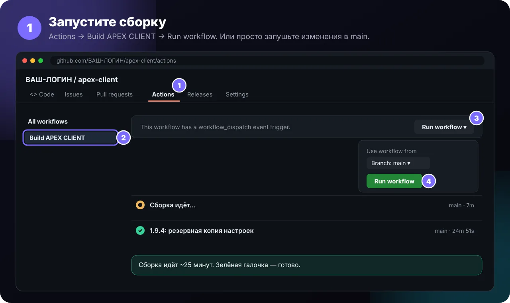
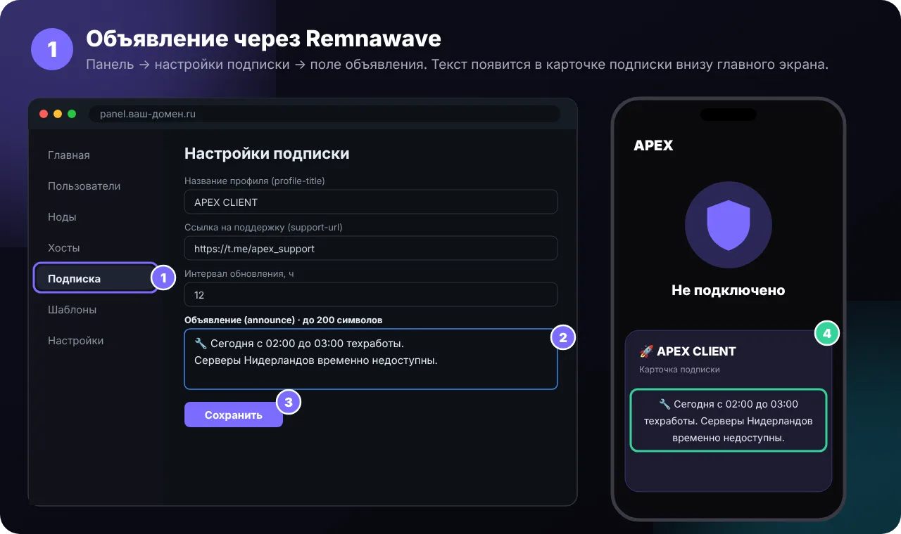

# 🧑‍💻 APEX VPN — инструкция для владельца

Эта страница — для того, кто выпускает приложение и держит панель. Пользователям она не нужна, им — [README](../README.md).

- [Выпуск новой версии](#release) · [Бета-версии](#beta) · [Ключ подписи](#signing)
- [Объявления для пользователей](#announce)
- [Адрес подписки](#subscription-address)
- [Подписка и Remnawave](#remnawave) · [Белые списки и LTE-обход](#whitelist)
- [Страница-приглашение](#pages)

---

<a id="release"></a>
<details>
<summary><b>🛠️ Как выпустить новую версию</b></summary>



1. В `app/build.gradle.kts` увеличьте `versionCode` и `versionName`.
2. Добавьте запись в `app/src/main/java/com/apexvpn/client/data/Changelog.kt` — она станет описанием релиза и текстом в окне обновления.
3. Запушьте в `main` — или **Actions → Build APEX VPN → Run workflow**. Сборка идёт около 25 минут.
4. Готово: в **Releases** появится `v<версия>`, а у пользователей — окно «Доступна версия».


> [!TIP]
> **Обязательное обновление** (окно без кнопки «Позже»): откройте релиз на GitHub → **Edit** → допишите в описание `[обязательно]` → **Update release**.

</details>

<a id="signing"></a>
<details>
<summary><b>🔑 Ключ подписи (один раз)</b></summary>

Все версии должны быть подписаны **одним** ключом — иначе Android не поставит новую поверх старой.

- **Сейчас** сборки подписываются постоянным ключом, который хранится в кэше GitHub Actions (раз в неделю сборка сама его «освежает», чтобы GitHub не удалил).
- **Надёжнее** — добавить свой ключ в секреты GitHub. Тогда он не потеряется никогда.

<details>
<summary><b>Как добавить свой ключ</b></summary>

1. Создайте ключ на компьютере с Java: `bash scripts/make-keystore.sh` (запомните пароль), затем `base64 -w0 apex-release.jks` — это значение для `APEX_KEYSTORE_BASE64`.
2. GitHub → **Settings → Secrets and variables → Actions → Secrets → New repository secret**:

| Name | Secret |
|---|---|
| `APEX_KEYSTORE_PASSWORD` | пароль ключа |
| `APEX_KEYSTORE_BASE64` | длинная строка целиком |

3. Запустите сборку. **Один раз** после смены ключа на телефонах нужно удалить старую версию и поставить новую.

> [!CAUTION]
> Ключ и пароль никому не отправляйте и не загружайте в репозиторий — только в секреты GitHub. Сохраните копию: без него обновления не встанут поверх.

</details>

</details>

> [!IMPORTANT]
> **Проверка оригинала:** проверка подписи работает, пока релизы подписываются вашим ключом из секретов `APEX_KEYSTORE_BASE64` / `APEX_KEYSTORE_PASSWORD`. Не удаляйте эти секреты и храните копию ключа: если ключ поменяется, отпечаток в `app/src/main/java/com/apexvpn/client/data/Integrity.kt` нужно обновить, иначе приложение назовёт свои же сборки копией.

<a id="beta"></a>
<details>
<summary><b>🧪 Бета-версии</b></summary>

1. Дайте версии имя со словом `beta`: `versionName = "3.18.0-beta1"` (следующая — `-beta2`), `versionCode` увеличьте как обычно.
2. Запушьте — GitHub опубликует релиз как **Pre-release**, «последней» останется обычная версия.
3. Бету получат только те, у кого включено **Настройки → Обновления → «Бета-версии»**.
4. Проверили — выпустите ту же версию без `beta` (`3.18.0`): её получат все, в том числе стоящие на бете.

</details>

<a id="announce"></a>
<details>
<summary><b>📢 Объявления для пользователей</b></summary>

Объявление показывается **в карточке подписки внизу главного экрана** приложения.

#### Через Remnawave



1. Откройте панель Remnawave → **Подписка** (настройки подписки).
2. Впишите текст в поле **объявления (announce)** — то же поле, что для Happ. До 200 символов, эмодзи можно.
3. Нажмите **Сохранить**.
4. Пользователи увидят текст при следующем открытии приложения (подписка обновляется, если прошло больше 30 минут) или при обновлении подписки кнопкой ↻.

**Убрать объявление:** очистите поле или впишите `0`.

**Картинка и кнопка** (с версии 2.3): допишите в текст объявления
- `` — картинка над текстом (только `https`, до 5 МБ);
- `[Продлить](https://ваш-сайт/pay)` — кнопка под текстом (ссылка `https://` или `tg://`).

Пример: `Скидка до конца месяца!  [Продлить](https://site/pay)`. То же можно передать заголовками `announce-image`, `announce-url`, `announce-button` (правило ответа в Remnawave).

> [!TIP]
> Если в вашей версии панели нет поля объявления — добавьте **свой заголовок ответа**: `announce: Текст` (или `announce: base64:…` для длинного текста с переносами). Ещё можно добавить строку `#announce: Текст` в начало тела подписки.


**Если объявление не приходит:** Remnawave отдаёт часть заголовков (объявление, описания серверов) только Happ и INCY. Добавьте правило ответа с `additionalExtendedClientsRegex: ["^APEX VPN/"]` — тогда APEX VPN получает то же, что Happ.

</details>

<a id="subscription-address"></a>
## 🔗 Адрес подписки

Какой адрес подписки принимает приложение, задаёт файл **[docs/config/subscription.json](config/subscription.json)**. Сменили домен — поправьте его прямо на GitHub (карандаш ✏️ → «Commit changes»), новую версию выпускать не нужно:

```json
{
  "hosts": ["sub.новый-домен.xyz"],
  "moved": { "sub.старый-домен.xyz": "sub.новый-домен.xyz" }
}
```

- **hosts** — разрешённые адреса; первый — основной, его приложение показывает в подсказках.
- **moved** — «старый → новый»: у всех пользователей сохранённая ссылка, старые приглашения и QR-коды сами переписываются на новый адрес (путь и токен те же).

Приложения подхватывают файл при запуске и раз в 6 часов (если GitHub недоступен — через зеркало jsDelivr, оно обновляется с задержкой до нескольких часов). Страница-приглашение читает тот же файл.

<a id="remnawave"></a>
## 🧩 Подписка и Remnawave

- Приложение понимает base64-список ссылок, обычный список, JSON sing-box и **Xray JSON** (как у Happ).
- Заголовки ответа: `profile-title`, `announce`, `support-url`, `profile-web-page-url`, `subscription-userinfo`, `profile-update-interval`. Их можно передать и строками `#имя: значение` в теле подписки.
- User-Agent: `APEX VPN/<версия>`.
- Remnawave отдаёт «Описание сервера» только Happ и INCY. Чтобы его видел APEX, добавьте правило ответа (Response Rule) с `additionalExtendedClientsRegex: ["^APEX VPN/"]`.

> [!TIP]
> кнопка «Открыть чат поддержки» появляется, только если в Remnawave заполнена **ссылка на поддержку (support-url)** в настройках подписки — например `https://t.me/ваш_бот_поддержки`. Без неё работает «Скопировать отчёт»: пользователь вставит его в любой чат. Если ссылка не приходит — проверьте [правило ответа](#announce) для `^APEX VPN/`.

<a id="whitelist"></a>
## 📶 Белые списки и LTE-обход

- LTE-обход приложение узнаёт по названию сервера: `LTE`, `📶`, `Обход`, `Bypass`, `Белые списки` и т. п.
- Если у «обхода» в панели особые настройки (XHTTP с `extra`, CDN-адрес), которые попадают только в **Xray JSON**, отдавайте APEX этот формат: **Subscription → Response Rules** → правило «`User-Agent` содержит `APEX VPN`» → тип ответа **`XRAY_JSON`**. Иначе APEX получит обычные ссылки — у них может быть другой адрес, и при белых списках он не откроется.
- Из Xray JSON приложение берёт только сервер (`outbounds` → `proxy` и его `dialerProxy`). Маршрутизация, DNS и порты из конфига не применяются — у APEX свои.

<a id="pages"></a>
## 💌 Страница-приглашение

> [!IMPORTANT]
> **Один раз включите страницу:** GitHub → **Settings → Pages** → Source: **Deploy from a branch** → Branch: **main**, папка **/docs** → **Save**. Через пару минут страница заработает по адресу выше.
